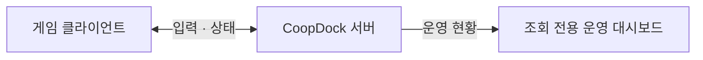

# CoopDock · 코옵독

[](https://github.com/sangjinsu/coopdock/releases/tag/v0.1.0)

**방을 만들고, 친구를 초대하고, 함께 움직이세요.**

CoopDock은 **1~6인 룸형 협동 게임을 위한 Go 서버 프로젝트**입니다.
6자리 룸 번호로 모여 서버가 계산한 상태를 공유합니다.
룸 입장부터 실시간 이동, Godot 게임 화면과 운영 조회까지 한 저장소에서 시작하세요.

[빠른 시작](docs/getting-started.md) · [Godot 3D/2D 예제](examples/godot/README.md) · [서버 사용·운영 가이드](docs/server-guide.md) · [v0.1.0 릴리스](https://github.com/sangjinsu/coopdock/releases/tag/v0.1.0)

## 작은 협동 게임을 위한 출발점

- **번호로 모이는 룸** — 공개 룸과 비밀번호가 있는 프라이빗 룸으로 플레이어를 모읍니다.
- **게임별로 나뉘는 룸** — 하나의 서버에서 `game_id`별로 룸 생성·목록·번호 입장을 분리합니다.
- **서버 권위 3D 이동** — 클라이언트의 이동 방향을 받아 서버가 위치와 속도를 계산하고 참가자에게 공유합니다.
- **Godot에서 바로 확인** — desktop 예제로 연결·룸 생성·입장·시작을 해 보고, 같은 서버 상태를 3D 공간과 2D XZ 평면으로 표시합니다.
- **한눈에 보는 운영 현황** — 브라우저의 조회 전용 대시보드에서 연결 수와 룸 상태를 확인합니다.

## 어떻게 연결되나요?



Godot 예제는 WebSocket + JSON으로 입력을 보내고 서버의 상태를 표시합니다.
운영 대시보드는 서버 현황을 조회합니다. 내부 구조는 [아키텍처 문서](docs/architecture.md)에 정리했습니다.

## 시작해 보세요

Go **1.26 이상**을 준비하고 저장소 루트에서 실행하세요.

```bash
go run ./cmd/server
```

서버가 `127.0.0.1:8080`에서 시작됩니다.
[Godot 예제](examples/godot/README.md)를 두 창으로 열어 같은 게임 ID와 룸에 접속하고, 방장이 게임을 시작하면 함께 움직일 수 있습니다.
서버만 먼저 확인하려면 [빠른 시작의 6개 WebSocket 연결 검사](docs/getting-started.md#4-여섯-연결로-검사하기)를 실행하세요.

## Go 패키지로 사용하기

릴리스 **v0.1.0**을 다른 Go 프로젝트의 module 루트에서 설치하세요. 새 module이라면 먼저 `go mod init example.com/my-game-server`를 실행합니다.

```bash
go get github.com/sangjinsu/coopdock@v0.1.0
```

다음은 **기존 host의 초기화에 넣는 함수**입니다. CoopDock을 host의 최상위 Handler로 연결하고, 종료할 때 사용할 instance를 반환합니다.

```go
import (
    "net/http"

    "github.com/sangjinsu/coopdock"
)

func configureCoopDock(host *http.Server) (*coopdock.Server, error) {
    service, err := coopdock.New(coopdock.DefaultConfig())
    if err != nil {
        return nil, err
    }
    host.Handler = service.Handler()
    return service, nil
}
```

host가 listener를 열고, 종료 시 `service.Shutdown(ctx)`와 `host.Shutdown(ctx)`를 모두 호출해 결과를 기다려야 합니다.
[전체 실행 예제](examples/go-embed/main.go)에서 listener·signal·종료 처리를, [Go embedding 가이드](docs/go-embedding.md)에서 기존 route와의 공존·설정·업데이트를 확인하세요.

현재는 **자유 공간 이동을 제공하는 초기 reference 구현**입니다.
게임별 지형·충돌·승패 규칙은 후속 범위이며, `game_id`는 게임별 룸을 구분하는 공개 namespace입니다.
지원 범위와 검증 한계는 [현재 단계](docs/server-guide.md#현재-단계)를 참조하세요.

| 문서 | 찾을 수 있는 내용 |
|---|---|
| [빠른 시작](docs/getting-started.md) | 준비부터 로컬 실행과 연결 검사까지 |
| [Godot 3D/2D 예제](examples/godot/README.md) | 두 창 실행, 룸 입장, 이동 조작과 표시 |
| [서버 사용·운영 가이드](docs/server-guide.md) | 현재 동작, 메시지 예제, 설정과 검증 |
| [대시보드 켜기](docs/server-guide.md#운영-대시보드-켜기) | 운영 인증 설정과 조회 화면 |
| [현재 서버 구조](docs/architecture.md) | 게임 처리와 운영 조회의 내부 경로 |
| [문서 길잡이](docs/README.md) | 기능 스펙, 전체 설계와 구현 기록 |
