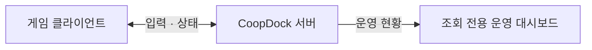

# CoopDock · 코옵독

**친구와 모이고, 같은 세계에서 함께 플레이하세요.**

CoopDock은 **1~6인 룸형 협동 게임을 위한 Go 서버 프로젝트**입니다.
6자리 룸 번호로 친구를 초대하고, 서버가 계산한 상태를 함께 공유하는 게임의 기반을 만듭니다.

## 작은 협동 게임을 위한 출발점

- **번호로 모이는 룸** — 공개 룸과 비밀번호가 있는 프라이빗 룸으로 플레이어를 모읍니다.
- **서버 권위 3D 이동** — 클라이언트의 이동 방향을 받아 서버가 위치와 속도를 계산하고 참가자에게 공유합니다.
- **한눈에 보는 운영 현황** — 브라우저의 조회 전용 대시보드에서 연결 수와 룸 상태를 확인합니다.
- **직접 확인하는 연결 흐름** — Go CLI로 실제 WebSocket 연결 6개의 입장·시작·이동·정지를 검사할 수 있습니다.

현재는 게임별 룸 분리, 자유 공간 이동, 운영 조회와 Godot 3D/2D 예제를 제공하는 **초기 reference 구현**입니다.
게임별 규칙과 검증 한계는 [현재 단계](docs/server-guide.md#현재-단계)에서 확인하세요.

## 어떻게 연결되나요?

클라이언트는 입력을 보내고 서버의 상태를 받습니다.
운영 대시보드는 서버 현황을 조회합니다. 내부 경로는 [현재 서버 구조](docs/architecture.md)에 정리했습니다.

## 시작해 보세요

Go **1.26 이상**을 준비하고 [빠른 시작](docs/getting-started.md)을 따라 서버와 6개 연결 검사를 실행하세요.
게임 화면으로 연결하려면 [Godot 3D/2D 예제](examples/godot/README.md)를 실행하세요.
운영 화면을 보려면 [대시보드 켜기](docs/server-guide.md#운영-대시보드-켜기)를 확인하세요.

| 문서 | 찾을 수 있는 내용 |
|---|---|
| [빠른 시작](docs/getting-started.md) | 준비부터 로컬 실행과 연결 검사까지 |
| [서버 사용·운영 가이드](docs/server-guide.md) | 현재 동작, 메시지 예제, 설정과 검증 |
| [현재 서버 구조](docs/architecture.md) | 게임 처리와 운영 조회의 내부 경로 |
| [문서 길잡이](docs/README.md) | 기능 스펙, 전체 설계와 구현 기록 |
