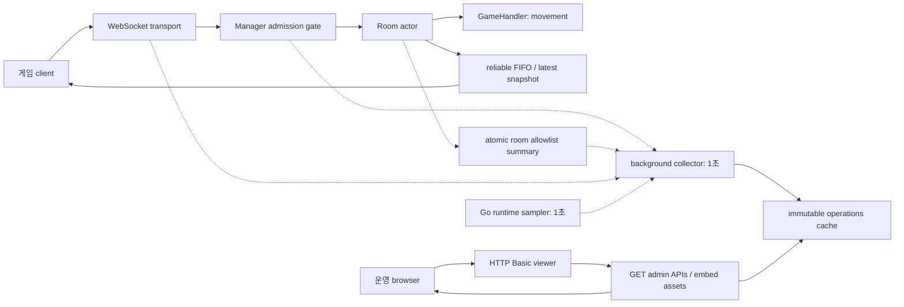

# 현재 서버 구조

이 문서는 현재 Go 서버의 게임 처리와 조회 전용 운영 대시보드 구조를 설명합니다.
후속 기능을 포함하는 [전체 설계](go-room-server-design.md)와 [기능별 스펙](specs/README.md)은 목표 설계입니다.
현재 실행 방법과 메시지 계약은 [서버 사용·운영 가이드](server-guide.md)에서 확인하세요.

[프로젝트 소개](../README.md) · [문서 길잡이](README.md)

## 게임 처리와 운영 조회

게임 입력은 room actor가 처리하고, 운영 조회는 별도 수집기가 만든 불변 cache를 읽습니다.
Actor→Outbox 선은 실제 `Session.Events`→transport outbox 단계를 요약합니다.
Manager는 registry refs와 readiness, WS는 실제 live 연결 수를 수집기에 제공합니다.
운영 GET에서 manager나 actor로 직접 조회하는 경로는 없습니다.

## 구조를 읽는 방법

- **게임 경로:** WebSocket transport가 받은 입력을 room actor와 movement handler가 처리합니다. 중요 응답·이벤트는 reliable FIFO로, 아직 보내지 않은 주기 snapshot은 최신 상태로 전달합니다. 정확한 tick·ACK·snapshot 규칙은 [실시간 3D reference 이동](server-guide.md#실시간-3d-reference-이동)을 참조하세요.
- **관측 경로:** actor의 allowlist summary, Manager의 registry refs·readiness, transport의 실제 live 연결 수를 background collector가 수집합니다. Go runtime sampler는 별도로 동작합니다. 주기와 자료의 의미, 미측정 범위는 [화면과 자료의 의미](server-guide.md#화면과-자료의-의미)를 참조하세요.
- **조회 경로:** 인증된 HTTP 요청은 게시된 운영 cache만 읽습니다. 화면과 API의 활성화·인증·조회 계약은 [운영 대시보드 켜기](server-guide.md#운영-대시보드-켜기)와 [룸 검색과 API](server-guide.md#룸-검색과-api)에 있습니다.

현재 운영 기능은 조회 전용입니다. 상세 화면·kick·close·drain·commands·지속 audit 등 후속 범위는
[운영 대시보드 스펙](specs/05-operations-dashboard.md)과 [운영 조작·종료 스펙](specs/06-operations-and-shutdown.md)에 정리되어 있습니다.
현재 제공 여부는 [서버 가이드의 현재 단계](server-guide.md#현재-단계)를 기준으로 확인하세요.
