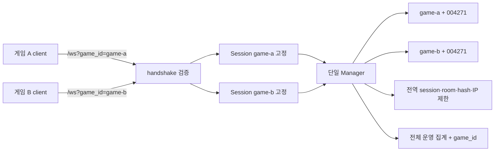

# 게임별 룸 격리 설계

기준은 `a580f71`의 서버와 Godot Task 1·2다. 사용자 요구는 하나의 서버를 여러 게임에서 사용하되 룸 생성·목록·참여를 게임별로 분리하는 것이다. 이 문서는 구현 전 계약이며 동작 검증 결과가 아니다. 소스 근거는 `work/game-scope/source-map.md`, 기존 wire는 `work/godot-client/protocol-contract.md`다. 이 문서의 namespace 계약은 기존 Godot 설계의 단일 `/ws`·서버 변경 없음 가정에 우선한다.

## 선택한 구조

**하나의 Manager와 전역 자원 제한을 유지하고, 룸 인덱스를 `(game_id, room_number)`로 바꾼다.** 연결 시 등록된 게임을 선택하여 Session에 고정한다. create/list/join/start/leave/action은 항상 그 Session을 사용한다.



| 대안 | 이점 | 현재 구조에서의 비용 | 결정 |
|---|---|---|---|
| 게임별 Manager | 기존 map·Session ownership·handler factory 경계 재사용 | MaxRooms/MaxSessions, IP failure limiter, hash worker/queue가 게임 수만큼 복제됨. 공유 자원 gate·worker 소유권·close/readiness/collector aggregation을 새로 설계해야 함 | 보류 |
| 단일 Manager + 구조체 key | 현재 전역 제한·lock 순서·worker·shutdown·collector 소유권 유지 | index 조회/삭제, actor admission, start/input과 list 경계에 명시적인 game 확인 필요 | 채택 |

`roomKey{gameID, number}` 구조체를 사용한다. 문자열 연결 key를 쓰지 않는다. Session과 actor의 `gameID`는 생성 이후 바꾸지 않는 비공개 필드다. `room_id`와 `session_id`는 기존 opaque random identity를 유지한다. 같은 6자리 번호를 서로 다른 게임에서 사용할 수 있고, 같은 게임에서만 충돌 재시도한다. 게임 A 연결에서 B에만 존재하는 번호로 join하면 `ROOM_NOT_FOUND`다. 같은 번호의 A 룸이 존재하면 A 룸에 참여하며 B 룸은 조회하지 않는다.

## 등록과 연결 계약

이름은 모든 계층에서 `game_id`/`GameID`로 통일한다. `app_id` 별칭은 제공하지 않는다.

- 서버 설정 `GAME_IDS`는 comma-separated allowlist다. 미설정 기본값은 `default`, 예시는 `GAME_IDS=default,game-a,game-b`다. 설정은 ID 양옆 공백을 제거한 뒤 검증하며 빈 항목·중복·잘못된 ID는 시작 실패다. 등록 수는 1~32개다.
- ID는 ASCII `[a-z0-9][a-z0-9_-]{0,63}`다. 대소문자 변환·Unicode normalization·별칭을 하지 않는다. Manager 생성 시 목록을 복사하여 외부 slice 변경으로 등록이 달라지지 않게 한다. 동적 등록 API는 없다.
- `GET /ws?game_id=game-a`의 query를 **Session 발급 및 WebSocket Accept 전에** 검증한다. 허용 query key는 `game_id` 하나다. raw query는 최대 1024 bytes로 제한한다. `url.ParseQuery(r.URL.RawQuery)`의 error를 반드시 확인하고 decoded map의 value 개수를 검사한다.
- 정상 ID가 정확히 한 번 있고 등록되어 있으면 해당 game으로 접속한다. encoded key도 decode 후 같은 key이므로 `game_id=a&game%5Fid=a`도 중복이다.
- `game_id`가 없으면 allowlist가 정확히 `["default"]`일 때만 default를 선택한다. 다중 게임 설정 또는 단일 named game이면 HTTP 400이다. default가 등록되어 있어도 다른 게임과 함께 등록되어 있으면 생략할 수 없다. 이는 단일 기본 게임의 기존 `/ws` 주소에만 적용하는 제한된 호환 경로다. 명시적인 빈 값은 default로 바꾸지 않는다.
- invalid/empty/duplicate ID, unknown query key, malformed percent encoding, unescaped semicolon, query 길이 초과는 HTTP 400과 고정 평문 `Invalid game selection.`이다. 문법상 정상이나 미등록 ID는 HTTP 404와 `Game was not found.`이다. 응답에 등록 목록·입력 원문을 반사하지 않는다.
- 닫히는 서버와 전역 자원 부족은 기존 HTTP 503 경로를 유지한다. 실패 handshake가 Session/active connection을 남기지 않아야 한다. upgrade 실패 후 Disconnect와 accept/close race 보호도 유지한다.

handshake는 HTTP 오류이므로 JSON envelope를 보내지 않는다. Godot는 구체 HTTP 본문을 얻지 못할 수 있으므로 연결 실패와 설정 확인 안내를 제공한다. namespace 선택은 공개 routing 정보다. 공격자가 새 연결에서 다른 등록 game_id를 선택하는 것은 막지 않는다. 게임별 인증·인가가 필요하면 별도 서버 검증 정책이 필요하며, 이번 작업에서 Godot에 client secret/API key를 넣거나 namespace를 인증 증명으로 표현하지 않는다.

## core API와 불변 조건

| API/상태 | 변경 계약 |
|---|---|
| `room.Config.GameIDs []string` | `DefaultConfig()`는 `["default"]`; NewManager는 1~32개의 유효·고유 ID를 검증하고 복사한다. `room.ValidGameID(string) bool`, `Manager.HasGame(string) bool`을 읽기 전용 helper로 제공한다. |
| `Manager.ConnectGame(peer, gameID string)` | 등록·문법 검사 후 전역 gate 안에서 Session을 생성한다. 잘못되거나 미등록 game은 `INVALID_MESSAGE`, Session을 만들지 않는다. |
| `Manager.Connect(peer string)` | 기존 Go 호출자를 위한 `ConnectGame(peer,"default")` wrapper. default 미등록이면 실패하며 첫 등록 게임으로 fallback하지 않는다. |
| `Session.GameID() string` | 생성 시 고정값을 읽는다. setter는 없다. `Session.ID()`와 함께 최초 응답에 사용한다. |
| `Manager.ListPublic(ctx, session)` | Session ownership·registry identity·closed 상태를 검사하고 같은 game의 published/public actor만 수집한다. 무조건 전체 목록을 반환하는 이전 overload는 남기지 않는다. |
| create / join | Session의 game으로 생성 및 key 조회. 요청 payload에서 game을 받지 않는다. |
| start / input | Session의 현재 actor, actor game == session game, composite index identity, membership token·match·sequence를 검사한다. actor 처리 시에도 동일한 관계를 다시 확인한다. |
| leave / disconnect / actor removal | committed actor 포인터·token 및 동일 game 관계로 정리한다. actor는 자신의 composite key만 identity 확인 후 삭제한다. 다른 게임의 같은 번호 룸을 지우지 않는다. |

`Manager.mu` 이후 `Session.mu`를 획득하는 현재 순서를 유지한다. 모든 map 접근 지점을 바꾼다: create collision/insert, join lookup, actor admit/run cleanup, Start/SubmitInput 및 actor start/input 재검증. namespace mismatch는 내부 불변 조건 실패이며 room lookup/admission에서는 `ROOM_NOT_FOUND`, 현재 membership 경로에서는 `NOT_IN_ROOM`처럼 해당 경계의 기존 일반 오류로 처리하고 상대 게임 정보를 노출하지 않는다. 정상적인 wire 요청으로 mismatch를 만들 수 없어야 한다.

private join은 형식검사 → session reservation → **해당 game의 room lookup** → password 누락/limiter/hash → actor phase/capacity 순서를 유지한다. 타게임 private 번호는 password 유무·오답·정답 모두 `ROOM_NOT_FOUND`이며 해당 룸의 비밀번호 hash 작업이나 실패 카운트를 수행하지 않는다. 잘못된 형식의 password는 기존처럼 lookup 이전 `INVALID_MESSAGE`일 수 있다. public 목록은 게임 필터 후 정렬·ListLimit을 적용한다.

## wire와 구버전 호환 범위

envelope의 5개 top-level 필드와 `version:1`, 모든 request payload는 유지한다. room RPC에 `game_id`를 보내면 기존 strict unknown-field 규칙으로 `INVALID_MESSAGE`다. 연결 이후 binding 변경 op는 없다. 게임을 바꾸려면 disconnect 후 새 연결·새 guest를 만든다.

```json
{"version":1,"op":"session.guest","request_id":null,"payload":{"session_id":"opaque-session","game_id":"game-a"},"error":null}
```

모든 full snapshot에 `game_id` string을 추가한다. create/join/start wrapper의 snapshot, direct room.state/game.snapshot, game.started/game.ended 내부 snapshot, room.list의 모든 항목이 포함된다. `game.action` ACK·leave ACK·game.event payload는 그대로다. 이 메시지들은 고정된 연결과 기존 membership/match fence에 속한다. 별도 per-request game 선택을 받지 않는다.

주소 `/ws`를 유지하는 것과 strict schema 호환은 다르다. 기존 Godot `WireCodec`은 guest/snapshot의 정확한 key 집합을 검사하므로 이 응답 확장을 거절한다. 서버와 예제를 함께 갱신한다. tolerant JSON consumer는 추가 필드를 무시할 수 있지만 검증하지 않은 모든 구버전 client의 호환을 보장하지 않는다. 별도의 legacy projection·protocol negotiation은 추가하지 않는다. server-guide에는 version 1 응답 schema 확장과 strict client 업데이트 필요를 명시한다. 갱신된 예제는 game_id 없는 구서버 응답도 거절하여 격리 확인 없이 준비 완료 상태가 되지 않게 한다.

## Godot 적용과 미완성 Task 3 경계

`CoopClient.connect_guest(base_url:String, game_id:String="default")`가 ID를 검증하고 `?game_id=`를 붙인다. base URL은 기존 `ws://`/`wss://` 주소이며 query·fragment가 없는 주소만 허용한다. caller가 query를 덧붙여 중복값/기대 game과 다른 값을 만들지 못하게 한다. 허용 ID가 ASCII 안전 문자뿐이므로 새 URI library는 필요 없다. Lobby는 기본 `default`인 게임 ID 입력과 현재 연결 게임 표시를 제공하며 연결 중에는 접속 설정을 잠근다. 일반 배포 게임은 자기 ID를 코드/공개 설정에서 지정한다.

`RoomState.game_id`를 연결 수명 동안 유지하고 `accept_guest(id,game_id)`에서 최초 값만 받는다. CoopClient는 요청한 ID와 guest의 ID 일치를 확인한 뒤 준비 완료로 전환한다. admission/event/list 모든 full snapshot의 game_id가 guest binding과 일치해야 한다. 틀린 guest/list/snapshot은 protocol 오류로 연결을 닫고 상태를 비운다. 단순히 타게임 행만 걸러 성공으로 표시하지 않는다. leave는 game_id를 유지하고 new_connection/disconnect만 초기화한다. 기존 connection generation·operation epoch·room/match freshness·input_seq 규칙은 유지한다.

새 unit 및 integration은 독립 파일로 둔다. 기존 Task 3의 `run_unit.gd`, `test_support.gd`와 10개 untracked scaffold는 보존한다. namespace worker는 기존 fixture에 필요한 `game_id` 추가와 guest API 변경만 좁게 조정할 수 있으며 Task 3 renderer/input/buffer/checker 구현은 맡지 않는다. 기존 25개 RED를 namespace 결과와 구분한다. root가 새 shared contract를 게시하고 namespace 검토 후 Task 3 owner가 같은 체크포인트에서 재개한다.

## 자원·운영·성장 경계

MaxRooms와 MaxSessions는 등록 게임 전체 합계다. hash worker 수·queue·Argon 자원·failure-key 상한·IP failure 카운터를 하나만 유지한다. session/room failure key는 기존 opaque ID를 쓰며 서로 다른 게임의 같은 번호가 한 룸 카운터로 합쳐지지 않는다. 같은 IP의 A 실패와 B 실패는 공유 IP 한도에 누적된다. 게임별 quota·공평한 스케줄링은 이번 범위가 아니므로 한 게임이 전체 용량을 사용할 수 있다.

Manager shutdown·transport Close·readiness·collector callback은 각각 하나를 유지한다. shutdown은 두 게임의 모든 세션/actor를 종료한다. `OperationsSummary`와 admin room row에 `GameID`/`game_id`를 추가하고 dashboard에 게임 열을 표시한다. 전체 counter와 health 의미는 서버 전체다. 운영 정렬은 `(game_id, room_number, room_id)`로 결정하여 같은 번호의 서로 다른 게임을 구분한다. admin은 이미 인증된 전체 운영 뷰이며 game별 tenant 권한 API가 아니다. 기존 `/admin/api/rooms`에 선택적 `game_id` exact filter와 dashboard 게임 입력을 추가한다. 생략은 전체, 명시값은 ID 문법을 만족해야 하며 잘못되거나 중복된 값은 400이다. 정상 문법의 미등록/빈 결과 ID는 200·matched_total=0이다. 필터 후 pagination하며 `total`과 status counter는 계속 전체, `matched_total`은 모든 필터 적용 후 수다. 별도 통계 endpoint는 추가하지 않는다.

10배 증가에서도 bounded room/session 수와 단일 hash pool이라는 상한은 유지된다. namespace 수만큼 worker를 늘리지 않는다. 목록은 현재 제한된 전역 map을 스캔한 후 해당 game만 capture한다. 측정 전 per-game index/cache나 horizontal routing을 추가하지 않는다. 이 변경은 처리량·지연·목표 Hz·격리된 CPU 예산을 보장하지 않는다.

등록된 게임 모두 현재 공통 movement handler와 `move` action/players snapshot을 사용한다. 기존 HandlerFactory seam은 유지하되 ID별 rules/plugin registry는 만들지 않는다. 실제 서로 다른 게임 규칙·action/state schema 지원은 후속 설계다. 이번 결과는 **여러 게임 namespace의 룸 격리와 공통 movement 예제**이며 모든 게임 로직을 자동 지원한다는 뜻이 아니다.

## 검증 완료 조건

default 단독 구성의 bare `/ws` 호환과 다중 게임 구성의 missing game_id 거절을 먼저 확인한다. 두 게임의 실제 WebSocket 연결로 guest binding, A create/B list 숨김/B join 실패, 각 게임에서 같은 번호 공존, 양쪽 start/move/stop/host leave와 다른 게임 이벤트 미전파를 확인한다. private 오류 순서와 타게임 번호 정보 비노출, override 거절, 잘못된 handshake 자원 미누수, 전역 room/session/IP/hash 제한, 전체 shutdown/운영 합계가 회귀되지 않아야 한다. 고정 번호는 test-only 기존 number seam으로 증명하며 production에 번호 선택 API를 추가하지 않는다. Go 최종 full/race/vet/build와 실제 Godot 두-game 검증을 별도 증거로 기록한 뒤 Architect가 승인한다.
