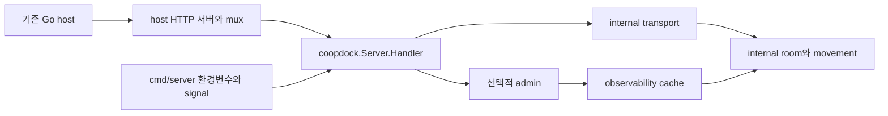

# Go 공개 패키지 설계

기준: 2026-10-18, `codex/godot-client-example`, `edc04b14cf63faa397a49ddf7e9457b112756b1a`. 이 문서는 구현 계약이며 구현·remote import·검증 완료 보고가 아니다.

## 목표와 범위

다른 Go application이 `github.com/sangjinsu/coopdock`을 import하여 기존 HTTP 서버 안에서 CoopDock의 guest 연결, 게임별 룸, 비밀번호 룸, 서버 권위 movement와 선택적 운영 화면을 실행하게 한다. 기존 CLI와 Godot v1 계약을 유지한다. 외부 host는 listener, HTTP timeout, TLS, process signal과 자신의 application 수명을 소유한다.

`internal/room`, `internal/transport`, `internal/game`, `internal/admin`, `internal/observability`는 유지한다. root package는 이 기능을 조립하는 public façade다. 내부 타입 alias, 임의 game/action plugin, DB·계정 연결, domain manager 직접 공개, 새 dependency는 이번 범위에 없다.

## Global Constraints

- Module path는 `github.com/sangjinsu/coopdock`, package name은 `coopdock`이다.
- `go.mod`의 Go 최소 버전은 `1.26.0`으로 유지하며 현재 검증 도구는 `go1.27.2 darwin/arm64`다.
- dependency는 기존 `github.com/coder/websocket v1.8.15`, `golang.org/x/crypto v0.58.0`, indirect `golang.org/x/sys v0.49.0`을 유지한다.
- 문서·사용자 보고는 한국어, 코드 주석은 영어, 기존 wire error와 CLI error 원문은 유지한다.
- `DefaultConfig`, `Validate`, `New`는 환경변수를 읽거나 signal handler·listener·process exit를 만들지 않는다.
- 게임 allowlist는 1~32개, ID는 기존 `ValidGameID` 규칙, 기본은 `default` 하나다. 룸 capacity는 기존 1~6이다.
- 설정은 `DefaultConfig()`에서 필요한 값을 바꾸는 방식이다. zero Config와 잘못된 값은 명시적 error이며 묵시적 zero-to-default 보정은 없다.
- 모든 공개 signature는 builtin·stdlib·공개 CoopDock 타입만 참조한다. internal alias와 `HandlerFactory`는 공개하지 않는다.
- 기존 game namespace·global resource cap·private admission·movement·Godot v1 schema·HTTP status를 유지한다.
- 개발 작업은 현재 feature branch에서 root 검토 후 commit/push한다. main merge와 tag는 범위에 없다.
- 임시 consumer Go source는 `/private/tmp` 아래 독립 module에 둔다. 실행 cache는 `work/` 또는 임시 경로를 사용한다.

## 구성과 인터페이스



정확한 공개 진입점:

```go
type Config struct {
    Room      RoomConfig
    Transport TransportConfig
    Admin     AdminConfig
}

type AdminConfig struct { ViewerToken string }

func DefaultConfig() Config
func (c Config) Validate() error
func New(c Config) (*Server, error)
func (s *Server) Handler() http.Handler
func (s *Server) Shutdown(ctx context.Context) error
```

`Server`의 필드는 비공개다. `New`로 만든 Server만 유효하다. `Handler()`는 같은 인스턴스의 안정된 handler를 반환하며 여러 HTTP 요청에서 동시에 호출할 수 있다. `Shutdown`에는 non-nil context를 전달한다. 별도 `Start`, `ListenAndServe`, `Close` alias, global singleton은 추가하지 않는다.

`RoomConfig`는 다음 필드만 가진다. `room.DefaultConfig`의 crypto 고정값과 movement factory는 내부 변환에서 유지한다.

| 필드 | 타입 | 기본값 / 허용 범위 |
|---|---|---|
| GameIDs | `[]string` | `["default"]`; 1~32개, 중복/공백 보정 없이 기존 ID 문법 |
| TickHz, SnapshotHz | `int` | 30, 15; 각각 1~120, SnapshotHz ≤ TickHz |
| InputQueue, InputsPerTick | `int` | 256, 64; 각각 1~4096, InputsPerTick ≤ InputQueue |
| MaxRooms, MaxSessions | `int` | 128, 768; 1~4096 / 1~24576 |
| NumberRetries | `int` | 64; 1~1024 |
| ActorQueue, CleanupQueue, EventQueue | `int` | 64, 6, 64; 1~4096 / 6~4096 / 1~4096 |
| ListLimit | `int` | 100; 1~1000 |
| HashWorkers, HashQueue | `int` | 2, 8; 1~16 / 1~256 |
| IPFailureLimit, SessionFailureLimit, RoomFailureLimit | `int` | 20, 5, 30; 각각 1~10000 |
| MaxFailureKeys | `int` | 4096; 3~65536 |
| FailureTTL | `time.Duration` | 1분; 0 초과~1시간 |
| RequestTimeout, ShutdownTimeout | `time.Duration` | 5초, 10초; 각각 0 초과~1분 |
| ArgonMemory | `uint32` | 19456 KiB; 19456~65536 |

`TransportConfig`는 다음 필드만 가진다.

| 필드 | 타입 | 기본값 / 허용 범위 |
|---|---|---|
| Origins | `[]string` | nil; 기존 origin host/port 검사, wildcard와 URL 형태 금지 |
| MessageLimit | `int64` | 16384; 256~1048576 bytes |
| IngressQueue, OutboundQueue | `int` | 16, 64; 각각 1~4096 |
| ReadTimeout | `time.Duration` | 120초; 0 초과~24시간 |
| WriteTimeout, RequestTimeout, ShutdownTimeout | `time.Duration` | 5초, 5초, 10초; 각각 0 초과~1분 |

`Admin.ViewerToken`은 기본 빈 문자열로 비활성화한다. 설정 시 기존 32~256 bytes, `0x21..0x7e`, HTTP Basic username `viewer` 규칙을 유지한다. public `Config.Validate`는 기존 CLI의 모든 상한과 교차 필드 제약을 적용한다. token 원문은 오류·로그에 출력하지 않는다. CLI의 `GAME_IDS` comma split/trim과 `WS_ORIGINS` parsing은 CLI loader에 남긴다. public Config는 이미 분해된 값을 받는다.

`DefaultConfig()` 호출마다 slice는 독립적이다. `New`는 `GameIDs`와 `Origins`를 복사한 후 보관한다. 호출자가 `New` 반환 후 원본 slice를 바꾸어도 실행 중 allowlist/origin 정책은 바뀌지 않는다. caller가 `New` 실행 중 같은 slice를 동시에 변경하는 것은 지원하지 않는다.

## 생성·종료 수명

1. `New`는 전체 설정을 검증한 뒤 manager → transport → 필요시 collector → handler 순서로 조립한다. 검증 실패 시 background worker를 시작하지 않는다.
2. admin 활성 시 collector 첫 cache 생성까지 최대 5초 기다린다. 아직 유효 cache가 없는 handler는 반환하지 않는다. 생성 도중 실패하면 이미 생성한 모든 service에 종료를 요청하고 cleanup을 끝까지 진행한다.
3. 각 Server는 manager·session·rooms·allowlist·limits·peers·collector를 따로 소유한다. 서로 다른 Server의 room namespace, 자원 한도, shutdown은 독립이다. 한 Server 안의 여러 game은 기존처럼 global cap을 공유한다.
4. `Shutdown`은 한 번만 closing 전환을 시작한다. collector를 STOPPING으로 표시하고 transport의 기존 admission fence, peer stop, manager close, wait-group 종료를 재사용한다. collector의 모든 worker도 종료 대상이다.
5. 이미 취소된 context로 호출해도 종료를 시작한다. caller context 또는 `Transport.ShutdownTimeout` 중 먼저 끝나는 대기 한도에서 반환할 수 있으나 cleanup은 계속된다. 종료 도중 새 valid WebSocket admission을 허용하지 않는다.
6. cleanup 전체가 끝났을 때만 nil을 반환한다. context deadline/cancel은 `errors.Is`로 검사할 수 있어야 한다. 여러 goroutine의 동시·반복 `Shutdown` 호출은 안전하며 먼저 timeout한 뒤 새 context로 완료를 다시 기다릴 수 있다. 이미 cleanup이 끝난 뒤 재호출하면 전달 context가 취소되어 있어도 nil을 반환한다. 완료된 인스턴스는 재시작하지 않는다. `sync.Once` callback은 종료 시작만 수행하고 전체 cleanup을 기다리지 않아 서로 다른 caller의 deadline을 묶지 않는다. 종료 시작을 background goroutine에만 맡겨 canceled caller 반환 후 admission이 살아 있는 창을 만들지 않는다.
7. `Shutdown`은 consumer의 HTTP 서버·listener·다른 handler를 종료하지 않는다. 전체 host를 종료할 때는 caller가 CoopDock 종료와 `http.Server.Shutdown`을 모두 호출하고 각 결과를 기다린다. HTTP 종료만으로 hijacked WebSocket이 닫힌다고 안내하지 않는다.

기존 endpoint 종료 정책을 유지한다. host listener가 살아 있다면 `/healthz`는 200, `/readyz`는 503이다. game query가 유효한 `/ws`는 503이며 query 오류는 기존 400/404 검사가 먼저 적용된다. admin 비활성은 404, 활성 admin은 기존 인증을 거쳐 cached STOPPING 상태를 제공한다. 최종 room counter가 반드시 0으로 갱신된다는 보장은 추가하지 않는다.

## host 라우팅과 admin 경계

`Handler`는 기존 `/healthz`, `/readyz`, `/ws`, `/admin` 및 하위 endpoint를 제공한다. 내부 조립에서는 `/admin` 또는 `/admin/` 접두 경로를 ServeMux 정규화 전에 admin handler로 전달한다. `/administrator`는 admin 경로가 아니다.

기존 host mux에는 고유 health route 등을 유지하고 CoopDock handler를 mount할 수 있다. `/one/`, `/two/`처럼 prefix를 쓰는 경우 `http.StripPrefix`가 CoopDock에 전달되는 경로를 조정하고 Godot URL도 해당 `/one/ws`처럼 설정한다. WebSocket을 지원하는 HTTP/1.1 writer/hijack 능력을 제거하는 middleware는 사용하지 않는다.

외부 `http.ServeMux`도 경로를 정규화하므로 `mux.Handle("/", service.Handler())`만으로 admin raw-prefix 경계를 보존할 수 없다. 예제는 최상위 `http.HandlerFunc`에서 `/coopdock/` mount prefix 전체를 먼저 식별해 `http.StripPrefix("/coopdock", service.Handler())`로 직접 보내고, 나머지는 기존 host mux로 전달한다. 두 인스턴스 검증도 `/one/`, `/two/`를 같은 방식으로 dispatch한다. `/coopdock/admin/../healthz`·중복 slash가 admin 인증 전에 redirect되어서는 안 된다. 추가 공개 middleware helper 없이 표준 library 조립 예제로 이 책임을 명시한다.

기존 dashboard HTML/JS는 `/admin/assets/*`, `/admin/api/*` 절대 경로를 사용한다. 따라서 prefix mount만으로 dashboard 브라우저 동작을 보장하지 않는다. 예제는 admin을 기본 비활성화한다. 활성화할 때는 host의 최상위 `/admin` 및 `/admin/` 경로도 같은 instance의 Handler로 직접 dispatch하여 기존 asset/API URL과 raw-prefix 인증을 보존한다. 기존 host가 이미 `/admin`을 쓰거나 한 origin에서 여러 instance의 dashboard가 필요한 경우 별도 origin을 사용한다. 임의 prefix dashboard UI 변경은 이번 범위에 없다. 두-instance 수명 검증은 admin off로, admin 활성화는 root alias와 직접 Handler를 대상으로 검사한다.

## CLI·wire 호환

`cmd/server`는 env loader → `coopdock.New` → host `http.Server`를 조립하는 공개 API consumer가 된다. `HTTP_ADDR`와 listen timeout, signal, 로그·exit code는 CLI가 유지한다. 기존 `ROOM_*`, `WS_*`, `GAME_IDS`, `ADMIN_VIEWER_TOKEN`의 parsing·기본값·검증과 shutdown error 결합을 유지한다. 공개 package는 `internal/config`를 import하지 않아 import cycle과 env 의존을 막는다.

default 단독 bare `/ws` 호환, multi/named-only missing `game_id` 400, malformed/duplicate 400, unknown 404, 게임별 create/list/join, 같은 번호의 다른 게임 공존, private password 순서, global cap, v1 envelope와 movement는 그대로다. 이번 작업으로 Godot production 파일을 변경할 필요가 없다면 변경하지 않고 실제 client를 공개 embedding 서버에 연결해 확인한다.

## 검증·배포 증거

- root package의 external test package는 public 타입만으로 compile·설정·HTTP/WS·수명을 검사한다. 내부 lifecycle failure injection은 비공개 test seam으로만 수행한다.
- 별도 temporary module에서 public import, 기존 mux와 custom health, 두 CoopDock 인스턴스, 하나의 인스턴스 안의 두 game, 실제 WS room/start/move, 한 인스턴스 shutdown 뒤 다른 instance와 host route 정상 여부를 확인한다.
- local `replace`는 개발 중 import 경계 증거다. push 뒤에는 replace와 workspace 없이 `go get github.com/sangjinsu/coopdock@codex/godot-client-example` 또는 실제 pushed SHA를 실행하고 resolved module version/commit을 기록하여 remote 소비를 별도로 입증한다.
- 아직 main의 public package를 보장하지 않으므로 문서에 bare `go get ...` 또는 `@latest`를 설치 성공 경로로 적지 않는다. branch query와 commit pin의 재현성 차이를 설명한다.
- module migration으로 이전 Go source hash는 새 결과의 근거가 될 수 없다. 새 production source hash·Go version·command·exit·log를 기록한다. production 변경 끝에 full Go test/race/vet/build를 각각 한 번 수행하고 후속 변경이 없으면 그 증거를 재사용한다.
- Godot default 실연결과 game scope runner를 embedding 서버 대상으로 실행한다. 기존 native 시각 QA나 목표 규모 성능을 새로 검증했다고 표현하지 않는다.

공식 API 근거: [go-public-package-api-references.md](go-public-package-api-references.md). 구현 순서: [go-public-package-plan.md](go-public-package-plan.md).
