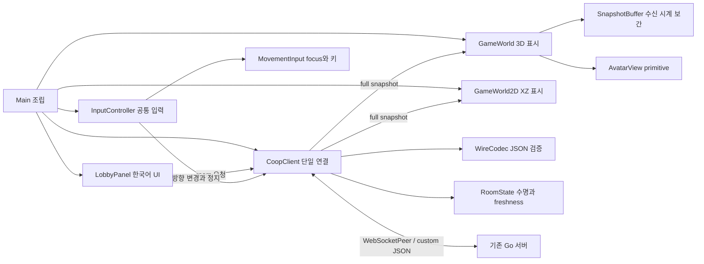

# Godot reference client 설계

이 설계는 `59dccc33c5f4bb3f939efb77b588301b74ab5b6b`의 Go 서버에 연결하는 desktop Godot 예제다. 사용자가 승인한 Go 서버·Godot·3D 방향과 이번 실행 요청을 구체화한다. 소스 조사 기록 `work/godot-client/protocol-contract.md`는 당시 wire 조사 자료다. 이후 namespace 변경에는 [게임별 룸 분리 설계](game-isolation-design.md)와 [현재 서버 계약](../server-guide.md)이 우선하며, 이 문서는 성능 보장을 정의하지 않는다.

## 실행 결과와 범위

`examples/godot/project.godot`을 Godot에서 열고 실행하면 한국어 lobby와 3D 게임 화면을 사용할 수 있다. 기본 endpoint는 `ws://127.0.0.1:8080/ws`다. URL을 바꾸고 연결하기, 1~6명 public/private 룸 생성, 6자리 번호 입장, 비밀번호 입력, public 목록 새로고침, host 시작, 퇴장과 수동 재연결을 제공한다. 하나의 창은 하나의 guest 연결을 소유한다. 외부 assets·SDK·dependency는 추가하지 않는다. 동일한 서버 상태의 XZ 평면을 보여 주는 2D 화면도 제공하며 상단 HUD에서 3D/2D 표시를 선택한다. 현재 실행·검증 범위는 [예제 안내](../../examples/godot/README.md)를 따른다.

Godot 4.4 이상, GL Compatibility renderer, desktop을 대상으로 한다. API 최소 기준은 공식 4.4 문서이며 실제 실행 검증은 설치 엔진 4.7.2로만 수행한다. 코드 주석은 영어, UI·설명은 한국어, 서버 error message와 로그는 원문을 유지한다. web export·TLS 배포·production 부하·목표 Hz 달성은 검증 범위가 아니다. UI 한국어 glyph가 기본 font에서 누락되면 설치된 한국어 system font를 fallback으로 사용하고 외부 font를 내려받지 않는다.

## 구조와 소유권

| 파일 | 책임 |
|---|---|
| `project.godot`, `scenes/main.tscn`, `scripts/main.gd` | 실행 가능한 project와 조립. 단계 1에서는 연결 상태를 보여 주는 최소 Control, 단계 2와 3에서 lobby/world를 결합한다. |
| `scripts/wire_codec.gd` | 5-field envelope 생성·검증, 번호·capacity·password·safe integer·vector 타입 검사. |
| `scripts/room_state.gd` | guest/room/match identity, local connection/operation epoch, metadata revision과 snapshot freshness. |
| `scripts/coop_client.gd` | 단일 socket reader, poll, pending request, timeout, heartbeat, input sequence와 상태 signal. |
| `scripts/lobby.gd` | 한국어 native Control, private 입력 workflow, full member/host 표시와 버튼 gating. |
| `scripts/movement_input.gd`, `scripts/input_controller.gd` | physical key와 focus의 방향 샘플, 모든 표시 모드의 유일한 입력 송신자. |
| `scripts/snapshot_buffer.gd` | 이전/최신 authoritative 위치와 local 수신 시각의 bounded 보간. |
| `scripts/avatar.gd`, `scripts/world.gd` | session ID별 primitive avatar, 즉시 생성·제거, 3D camera·바닥·조명과 권위 위치 표시. 입력을 송신하지 않는다. |
| `scripts/world_2d.gd` | 동일 snapshot의 XZ 평면, built-in circle/grid/Label로 구성하며 입력을 송신하지 않는다. |
| `tests/test_support.gd`, `tests/run_unit.gd` | deterministic fixture와 headless 행위 검사. |
| `tests/test_driver.gd`, `tests/run_integration.gd` | 실제 Go 서버와 여섯 Godot client, bounded 응답/캡처 비교. |
| `tests/run_render_qa.gd`, `tests/run_checks.sh` | 엔진 입력·화면 캡처, 테스트 실행과 소유 process 정리. |

한 파일이 transport·UI·world를 모두 소유하는 구조를 피한다. `.gd`와 `.gd.uid`는 version control에 포함하고 `.godot/` import cache, 로그·PNG·테스트 executable은 ignored `work/godot-client/`에 둔다.

## 현행 namespace 계약

초기 단일 `/ws`·Go 무변경 전제는 후속 namespace 작업이 확장했다. Go 변경은 namespace 작업이 담당했고 Godot 작업은 Go를 변경하지 않았다. 서버는 `GAME_IDS`로 게임을 등록한다. `CoopClient.connect_guest(base_url:String, game_id:String="default")->Error`는 query/fragment 없는 base URL에 명시적 game query를 붙인다. bare `/ws` 호환은 등록 목록이 정확히 `default` 하나일 때만 허용된다.

`RoomState.game_id:String`, `accept_guest(id:String, game_id:String)->void`를 사용하며 연결의 게임은 고정된다. guest·list·모든 full snapshot의 `game_id`가 연결 게임과 맞지 않거나 누락되면 protocol 오류로 닫는다. leave는 게임 binding을 보존하고 새 연결은 비운다. version 1의 추가 필드를 엄격히 검사하는 구버전 client는 함께 업데이트해야 한다. 공개 namespace는 인증이 아니며 게임들은 전역 자원 한도·공통 이동 handler를 공유한다. 아래 과거 구현 순서와 시험 기록은 완료 증거로 소급 해석하지 않는다.

## 연결·요청·비밀 값

`WebSocketPeer.connect_to_url()`은 비동기 연결 시작이다. 매 frame `poll()`하고 OPEN에서만 text를 보낸다. CONNECTING과 CLOSING도 poll하며 CLOSED에서 한 번만 cleanup한다. OPEN은 guest 준비 완료가 아니다. 첫 `session.guest`를 받기 전 room 버튼을 활성화하지 않는다. `get_packet()` 뒤 `was_string_packet()`을 검사하고 binary/깨진 JSON/잘못된 envelope는 연결 오류로 처리한다. 하나의 reader가 응답과 이벤트를 모두 dispatch한다. connect 전에 `inbound_buffer_size=1048576`, `outbound_buffer_size=1048576`, `max_queued_packets=256`을 설정한다. client text packet은 최대 1MiB, frame당 최대 64 packet을 처리한다. 서버의 요청 16KiB 제한과 room.list 응답 크기를 혼동하지 않는다.

요청은 정확히 `{version:1,op,request_id,payload,error:null}`이다. request ID는 `c<connection>-r<counter>`처럼 128 UTF-8 bytes 이내의 비어 있지 않은 string으로 만든다. pending은 최대 64개이며 expected op, connection generation, operation epoch, deadline만 보관한다. password와 요청 payload 원문을 pending·로그에 저장하지 않는다. 실패 UI는 code의 한국어 설명과 서버 원문 message를 보여 준다.

기본 local request timeout은 10초다. create/join timeout은 socket을 닫고 모든 상태를 비운 뒤 사용자가 새 guest로 재연결하도록 안내한다. 이는 이미 서버에 commit된 늦은 admission과 모호한 소속을 남기지 않기 위한 정책이다. 다른 timeout도 pending을 제거하며 늦은 unknown reply는 상태를 바꾸지 않는다. 자동 RPC 재전송·비밀번호 오답 재시도는 없다. start/leave 수명 요청이 local timeout으로 모호해지면 같은 disconnect 정책을 적용한다.

기본 30초마다 유효한 `room.list {}`를 보내 read deadline을 갱신한다. 이 값은 client 설정이고 서버가 advertise하지 않는다. 서버의 `WS_READ_TIMEOUT`이 더 짧다면 heartbeat interval을 함께 줄인다. `ping`/`heartbeat` wire op를 만들지 않는다. max_pending 포화 시 새 요청을 거절하며 이동 방향은 다음 여유 frame에서 다시 보내도록 pending direction을 유지한다.

public create에는 password 필드 자체를 넣지 않는다. private create password는 4~64 Unicode code points, 정확한 입력을 유지한다. room number는 ASCII `[0-9]` 6자리 string이며 선행 0을 보존한다. join에서 비밀번호를 모르면 필드를 생략한다. `PASSWORD_REQUIRED` 뒤 같은 번호의 password UI를 열고, `PASSWORD_INVALID`에는 사용자의 다음 입력을 기다린다. 정원·진행 여부는 올바른 password 검증 뒤 서버 결과를 따른다. password를 trim·normalization하지 않는다. 성공·퇴장·disconnect 시 secret 입력을 비운다.

## 상태와 늦은 메시지

세션·room·match는 전체 ID로 비교한다. 짧은 표시 ID를 map key나 자기 자신·host 판단에 사용하지 않는다. `RoomState`는 connection generation, admission operation epoch, 현재 full snapshot, retired match ID를 관리한다. socket 교체 시 session·room·members·players·pending·buffer와 input_seq를 모두 초기화한다. 같은 socket의 leave/new room/new match에서는 input_seq를 초기화하지 않는다.

| 입력 | 수용 정책 |
|---|---|
| matching create/join success `{snapshot:full}` | pending connection/op epoch와 일치할 때만 소속 기준 상태로 채택한다. |
| `room.state` direct full | current room ID 일치, revision 비역행. membership/host는 즉시 적용한다. started/ended와 같은 capture의 duplicate는 harmless하다. |
| start reply / `game.started` `{snapshot:full}` | current room, 유효한 새/current match, lifecycle revision 기준. initial tick 0을 periodic filter로 버리지 않는다. |
| `game.snapshot` direct full | current room/current active match, snapshot_seq 증가일 때만 game state 채택한다. |
| `game.ended` `{match_id,reason,server_tick,snapshot}` | current match 종료만 수용하고 retired match를 기록한다. WAITING과 buffer 비우기는 즉시 처리한다. |
| `room.list` `{rooms:[full...]}` | 목록 signal만 보낸다. listing snapshot으로 자기 room이나 위치를 바꾸지 않는다. |
| `game.action` ACK `{match_id,input_seq,server_tick}` | matching pending만 완료한다. 위치를 만들거나 buffer를 갱신하지 않는다. |
| leave 시작 / disconnect | room acceptance를 먼저 fence하고 members·players·buffer를 즉시 비운다. 늦은 event가 이전 room을 되살리지 못한다. |

wrapper와 direct full을 구별한다. `game.member_left`, client end RPC, `tick_hz`, `snapshot_hz`, `idle_timeout`, wire membership token은 존재하지 않는다. 퇴장은 full snapshot에서 빠진 member/player로 판단한다. 기본 movement는 마지막 참가자가 나갈 때까지 계속될 수 있다.

## 3D 입력과 표시

W/S 또는 위/아래 화살표는 -Z/+Z, A/D 또는 왼쪽/오른쪽 화살표는 -X/+X, Q/E는 -Y/+Y다. 조합 방향 길이가 1보다 크면 normalize한다. key repeat를 입력 수로 적분하지 않고 매 frame 현재 방향을 샘플한다. 방향이 바뀔 때만 `game.action`을 보내고, release·window focus 상실·LineEdit/TextEdit focus·게임 종료에서 zero direction을 보낸다. focus 상실 후 key release 누락으로 재활성화될 수 있으므로 다시 focus를 얻을 때 `Input` action 상태를 clear한다. input gate는 Main의 root Window `has_focus()`와 `gui_get_focus_owner()`를 사용한다. world를 SubViewport에 넣어도 lobby의 LineEdit focus를 이 경로로 검출한다. focus 상실 시 socket이 이미 닫혔다면 보낼 수 없다는 연결 한계를 안내하며 reconnect에는 방향이 zero다.

입력 wire는 `{match_id,input_seq,action:{type:"move",direction:{x,y,z}}}`뿐이다. input_seq는 연결 수명 전체에서 1..9007199254740991 증가한다. 성공 send에 번호를 소비하고 거절된 요청도 다음 번호를 사용한다. ACK는 Apply+Tick 완료이며 위치를 포함하지 않는다. 자기 avatar도 snapshot position만 사용한다. local movement prediction, extrapolation, physics, collision, gravity, `@rpc`는 추가하지 않는다.

카메라는 scene tree에 넣은 뒤 `look_at()`한다. Godot camera의 -Z forward 규칙을 따른다. 바닥은 시각적 plane이고 충돌 바닥이 아니다. avatar 중심을 위치에서 일정 높이만큼 띄워 캡슐을 보여 주되 서버 position 값은 변경하지 않는다. `AvatarView.set_avatar_identity(id, is_self, is_host)`로 자신과 host를 색·label로 구분한다. 이 이름은 inherited `Node3D.set_identity()->void`와의 충돌을 피한다. game world는 PLAYING에만 활성화한다.

보간은 local monotonic 수신 시계로 한다. 처음 받은 player는 최신 위치를 즉시 표시한다. 같은 room/match의 이전·최신 위치를 두 개만 보관하고 최신 수신 gap을 16~200ms로 clamp한다. `alpha=clamp((now-latest_received)/duration,0,1)`로 이전→최신 position을 lerp한다. 수신 gap이 500ms를 넘으면 이전 sample을 버리고 최신 위치로 즉시 snap한다. 새 snapshot이 없으면 최신 위치에서 멈춘다. 없어진 player는 최신 metadata/players에서 즉시 제거하고 이전 buffer에서 부활시키지 않는다. match/room/connection 변경 시 buffer를 비운다. burst나 긴 gap에서도 저장량과 표시 duration은 bounded다.

receive clock과 server simulation clock은 동기화되지 않는다. 이 표시 방식에는 추가 지연이 있으며 모든 창이 같은 순간의 위치를 표시한다는 보장이 없다. `server_tick`/`snapshot_seq` 차이를 고정 30/15Hz나 wall-clock 지연으로 해석하지 않는다.

## 2D 표시와 모드 전환

2D는 같은 서버 `position:{x,y,z}`를 `Vector2(x,z)`로 투영한다. W/위는 화면 위(-Z), S/아래는 +Z이며 좌우는 X다. pixel scale은 32px/world unit이고 화면 중앙을 origin으로 둔다. y는 화면에 표시하지 않지만 서버 값은 그대로 유지한다. 2D의 Q/E는 비활성화하여 direction.y=0을 보낸다. 서버 position.y를 0으로 순간 이동시키는 요청은 없다.

InputController 하나만 keyboard를 sample하고 game.action을 송신한다. 비활성 2D/3D renderer는 입력을 보내지 않는다. 모드 변경 때 가능한 경우 zero를 먼저 전송하고 action 상태와 양쪽 render timeline을 비운 뒤 현재 snapshot을 즉시 표시한다. session·room·match·input_seq는 유지한다. 원·격자·Label 같은 built-in Node2D로 여섯 avatar를 구분한다. 서버 권위·보간·퇴장·host·비밀번호 workflow는 3D와 공통이다.

3D 실서버 여섯 client와 두 native 창 QA를 먼저 완료하고 commit한다. 그 다음 2D unit과 실제 mixed 3D/2D 두 창에서 이동/정지/같은 capture/모드 전환을 검증한다. synthetic engine input과 수동 OS keyboard 관찰은 구분한다.

## 검증과 증거 경계

headless unit은 잘못된 envelope·JSON 숫자·번호·secret payload, pending timeout, old admission/connection/match, revision과 duplicate, seq lifetime, player 제거와 보간 endpoint, focus/zero를 검증한다. 실제 서버 통합은 Godot `WebSocketPeer`를 가진 여섯 `CoopClient`가 guest→입장→host start→move/stop ACK→공통 capture 비교→퇴장·host 승계를 수행한다. 추가 연결로 7번째 admission 거절을 확인하고, 별도 두 연결에서 private 누락/오답/정답을 확인한 뒤 모두 닫는다. private list 제외, capacity 1·6, 올바른 password 후 ROOM_FULL/ROOM_IN_PROGRESS 순서도 확인한다.

두 독립 native Godot 창에서 실제 scene을 렌더하고 viewport PNG를 저장한다. synthetic `Input.parse_input_event()`는 Godot 엔진 입력 경로 검증이라고 기록하며 실제 OS keyboard 수동 조작으로 표현하지 않는다. 한국어 glyph·lobby 크기·자신과 상대 avatar·camera·정지와 focus gating을 눈으로 확인한다. Go 기존 test 결과, 새 Godot unit, 실제 Godot wire, native 렌더를 별도 수치로 보고한다. 기존 Go source/dependency가 바뀌지 않으면 기존 full suite를 이번 Godot 결과로 다시 주장하지 않는다.

## 공식 API 기준

공식 조사 기록 `work/godot-client/official-godot-research.md`를 구현 전에 읽는다. [WebSocketPeer](https://docs.godotengine.org/en/4.4/classes/class_websocketpeer.html), [Input](https://docs.godotengine.org/en/4.4/classes/class_input.html), [Window](https://docs.godotengine.org/en/4.4/classes/class_window.html), [Time](https://docs.godotengine.org/en/4.4/classes/class_time.html), [Node3D](https://docs.godotengine.org/en/4.4/classes/class_node3d.html), [Viewport](https://docs.godotengine.org/en/4.4/classes/class_viewport.html)을 기준으로 한다. Node2D draw/queue_redraw는 실제 4.7.2 reflection으로 확인한 API이며 최신 optional 인자를 4.4에 추측 적용하지 않는다. 핵심 API는 WebSocketPeer의 connect/poll/ready state/text packet, JSON parse 결과, Time monotonic ticks, physical key input과 focus, Camera3D look_at, native Control과 primitive mesh, viewport image capture다. 이 문서가 engine API를 추측해 추가하지 않도록 실행 계획은 해당 조사 결과와 함께 읽는다.
