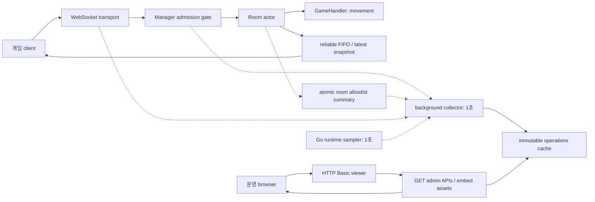

# Operations Dashboard Implementation Plan

> **For agentic workers:** REQUIRED SUB-SKILL: Use superpowers:subagent-driven-development to implement this plan task-by-task. Steps use checkbox (`- [ ]`) syntax for tracking. 사용자 지시에 따라 담당 worker가 구현하고 독립 reviewer가 각 작업을 검토한 뒤 local commit한다.

**Goal:** 기존 CoopDock 설계대로 인증된 운영자가 public/private 룸 목록, 실제 WebSocket 접속자 수, 서버 상태를 읽는 대시보드를 제공한다.

**Architecture:** Room actor는 게임 snapshot과 독립된 allowlist 요약을 atomic으로 게시한다. background collector와 runtime sampler가 불변 cache를 만들고, 인증된 HTTP handler는 cache만 읽는다. Go 실행 파일에 포함한 HTML/CSS/vanilla JS가 5초 polling과 페이지 탐색으로 이를 표시한다.

**Tech Stack:** 기존 Go `1.26.0` module, `net/http`, `embed`, `crypto/sha256`, `crypto/subtle`, `sync/atomic`, 기존 WebSocket 라이브러리, vanilla HTML/CSS/JS. 신규 dependency·framework·runtime·Node build 없음.

**Spec:** `docs/specs/05-operations-dashboard.md`, `docs/specs/04-messages-and-api.md`의 조회 API, `docs/specs/06-operations-and-shutdown.md`의 운영 인증·종료 경계, `docs/specs/07-implementation-and-config.md`의 단계 4. 실행자는 이 계획과 해당 spec을 함께 읽는다. API 공식 조사 `work/dashboard/official-api-research.md`, seam 조사 `work/dashboard/exploration.md`, 시각 방향 `work/dashboard/ui-design.md`는 내부 근거다. 이 계획의 확정 계약이 보고서의 제안·미확정 값보다 우선한다.

## Global Constraints

- 작업 기준은 clean `codex/room-entry`, `2f8df148c73aabdd6169b32fb2cd62fff2a82f1a`다. 현재 checkout에서 순차 작업하며 공유 파일은 작업 종료 때 소유권을 넘긴다.
- 모든 설명·화면·문서는 한국어, 코드 주석은 영어, 에러 메시지·로그 원문은 유지한다.
- 기존 설계와 실행·작업별 commit은 승인되었다. 새 승인 인터뷰나 기능 확장 없이 실행한다. 다른 작업자의 변경을 되돌리지 않는다.
- 작업마다 RED→GREEN→기존 suite→독립 검토→local commit. root의 최종 Architect 검증을 통과하기 전 완료를 주장하지 않는다. GitHub push는 필수 단계가 아니다.
- 조회 범위는 `GET /admin`, `/admin/api/status`, `/admin/api/rooms`와 인증된 정적 파일이다. 룸 상세, 연결 상세, kick/close/drain 실행, commands/audit, 계정 관리, JWT/session/OIDC는 후속이다.
- public/private 모두 운영 조회에 표시한다. password·hash·salt·운영 token·전체 member ID 목록·game_state는 summary/cache/API/HTML/로그에 넣지 않는다. 게임 `room.list`는 기존 public-only 계약을 유지한다.
- `snapshot()` 재사용, 운영 요청에 따른 game revision/snapshot_seq 변경, HTTP→manager/actor lock·callback·runtime sampling은 금지한다.
- actor summary 1초, collector 1초, runtime sampler 1초, stale 기준 `age_ms >= 5000`, UI polling 완료 후 5초, 요청 batch timeout 5초다.
- 운영 인증은 HTTP Basic, username `viewer`, 운영 전용 환경 변수 `ADMIN_VIEWER_TOKEN`이다. token 미설정 또는 빈 값이면 모든 admin route 404, collector/runtime sampler 생성 없음. 설정된 값은 길이 32..256 bytes, 각 byte `0x21..0x7e`만 허용한다.
- actor의 1초 summary heartbeat는 admin 비활성 때도 유지한다. 설정과 timer 종류를 늘리지 않는 작은 고정 비용이며 room 최대치는 기존 `ROOM_MAX_ROOMS`로 제한된다. 비활성 상태에서 collector/runtime sampling loop는 0개다. 이 고정 게시 비용과 실제 게임 부하 영향 미측정 사실을 문서화한다.
- 모든 admin 응답에 no-store, self CSP, nosniff, frame deny를 적용한다. 공개 login shell·외부 CDN·외부 font/image 없음. `WS_ORIGINS`는 admin 인증 정책에 사용하지 않는다.
- 운영 HTTPS는 기존 reverse proxy 가이드로 설명한다. 이번 작업에 배포·TLS 설정·유료 계정 변경을 추가하지 않는다.

## Review Focus

1. **막힌 actor와 늦은 callback:** 마지막 자료는 stale로 바뀌고 HTTP는 cache만 읽어 끝나며 Close 호출자는 deadline 안에 반환한다. Task 1 `TestOperationsHeartbeatBlockedActor`, Task 2 `TestCollectorStaleAndBoundedClose`, Task 3 `TestAdminReadsOnlyCache`.
2. **pre-upgrade guest와 중복 stop 경합:** 아직 accept되지 않은 session은 접속자로 세지 않고 살아 있는 연결만 정확히 한 번 증가·감소한다. Task 2 `TestLiveStatusBeforeAcceptAndStopRace`.
3. **닫힌 룸·번호 재사용·공유 pointer:** 다음 수집에서 옛 RoomID가 사라지고 반환 요약을 변경해도 이후 자료가 변하지 않는다. Task 1 `TestOperationsRegistryReuseAndClone`.
4. **잘못된 인증·경로·query:** 설정 token은 오류/응답에 새지 않으며 private 자료·자산은 매 요청 인증 후 제공하고 malformed/duplicate/unknown query는 400이다. Task 3 `TestAdminAuthAndRoutes`, `TestRoomsQueryBounds`.
5. **느린 응답·권한 취소·129개 룸:** 요청이 겹치거나 옛 결과가 새 필터를 덮지 않고 인증 상실 때 민감 자료가 사라지며 마지막 페이지도 조회된다. Task 4 browser QA와 Task 5 실제 실행 검증.

---

## 파일 경계와 확정 인터페이스

| 작업 | 소유 파일·책임 |
|---|---|
| Task 1 | `internal/room/operations.go`, `operations_test.go`; 기존 `actor.go`, `realtime.go`, `manager.go`, `types.go`의 summary 게시·독립 ticker seam |
| Task 2 | `internal/transport/server.go`, 기존 `server_test.go` helper 재사용, 새 `operations_test.go`; `internal/observability/collector.go`, `collector_test.go`: 실제 live count와 불변 수집 cache |
| Task 3 | `internal/admin/auth.go`, `http.go`, `web.go`, 각 시험, `internal/admin/web/index.html`, `dashboard.css`, `dashboard.js`; `internal/config/config.go`, `config_test.go`; `cmd/server/main.go`, 새 `main_test.go`: 인증·API·보호된 skeleton·설정·wiring |
| Task 4 | `internal/admin/web/index.html`, `dashboard.css`, `dashboard.js`: 한국어 UI·polling·browser QA |
| Task 5 | `README.md`, `docs/server-guide.md`, `docs/specs/README.md`, `01-overview.md`, `04-messages-and-api.md`, `05-operations-dashboard.md`, `07-implementation-and-config.md`, `08-validation.md`, `docs/go-room-server-design.md`: 구현 상태·사용 가이드·구조도·최종 검증 |

`room`은 admin/observability/transport를 import하지 않는다. `observability`는 room 값 타입과 표준 라이브러리만 사용한다. `admin`은 observability를 소비한다. `config`는 room/transport와 admin 설정을 소비하며, `cmd/server`가 모든 source callback을 연결한다. 기존 `transport.New`, `Handler`, `Close` signature는 유지한다.

### Room summary

```go
// internal/room/operations.go
package room

type OperationsSummary struct {
    RoomID, RoomNumber, Visibility, Phase string
    Capacity, MemberCount int
    HostID string
    MatchID *string
    UpdatedAt time.Time
}
type OperationsSnapshot struct {
    Ready bool
    Rooms []OperationsSummary
}
func (m *Manager) OperationsSnapshot() OperationsSnapshot
func (r *actor) publishOperations(now time.Time)
func (v OperationsSummary) clone() OperationsSummary
```

위 declaration block은 계약이다. 실제 파일에는 `time` import와 구현을 넣는다. Phase는 `WAITING`/`PLAYING`, Visibility는 `public`/`private`만 게시한다. `MatchID`는 WAITING이면 nil이다. UpdatedAt은 monotonic 성분이 있는 원래 `time.Time`을 보관하고 HTTP 표현 때만 UTC로 변환한다. `Config`에 private `newOperationsTicker func(time.Duration) (<-chan time.Time, func())`와 `operationsNow func() time.Time` hook을 추가한다. 기존 `newTicker`, 실패 제한용 `now`와 분리한다. 기본은 time.NewTicker/time.Now이며 새 환경 설정은 없다.

actor의 최신 pointer와 operations ticker는 actor에 둔다. 게시 함수는 actor 소유 필드에서 primitive allowlist만 복사하고 새 `OperationsSummary`를 atomic Store한다. publish 후 객체·MatchID pointer를 변경하지 않는다. collector가 없어도 게시가 끝나며 channel send·manager callback·receiver wait가 없다. registry와 `published` 확인은 Manager.mu 아래 actor refs만 복사한 후 잠금을 풀고 atomic Load/clone한다. manager callback에서 actor command를 보내지 않는다. 현재 published room registry를 매번 전부 재구성하며 RoomID로 중복/identity를 판단한다. ref 복사 직후 닫힌 룸은 한 수집에 남을 수 있으나 다음 수집에는 제거된다.

### Transport live status

```go
// internal/transport/server.go
func (s *Server) LiveStatus() (activeConnections int, stopping bool)
```

WebSocket upgrade 성공 뒤 server gate에서 peer 등록과 count 증가를 함께 확정한다. 아직 등록 안 된 peer의 stop은 감소시키지 않는다. `peer`의 counted 상태는 server gate로 보호한다. `stopOnce` 경계에서 counted면 한 번만 감소시키고 false로 바꾼다. deferred accept cleanup도 같은 idempotent helper를 사용한다. `LiveStatus`는 이 gate에서 counter/closing만 읽으며 manager session 수를 이용하지 않는다. 따라서 guest 연결은 포함하고 `room.leave`는 count를 줄이지 않는다. 실제 socket 종료/cancel 뒤의 count 감소와 registry cleanup 완료는 다른 시점이다.

### Collector lifecycle와 immutable cache

```go
// internal/observability/collector.go
package observability

type State string
const (
    Running State = "RUNNING"
    Stopping State = "STOPPING"
)
type Source struct {
    Rooms func() room.OperationsSnapshot
    Transport func() (activeConnections int, stopping bool)
}
type Config struct {
    Interval time.Duration
    now func() time.Time
    newTicker func(time.Duration) (<-chan time.Time, func())
    sampleRuntime func() (heapAllocBytes uint64, goroutines int)
}
const StaleAfter = 5 * time.Second
func DefaultConfig() Config // Interval=1s
func New(startupCtx context.Context, source Source, cfg Config) (*Collector, error)
func (c *Collector) Load() Snapshot
func (c *Collector) MarkStopping()
func (c *Collector) Close(ctx context.Context) error

type Snapshot struct {
    ServerInstanceID string
    State State
    Ready bool
    ActiveConnections, RoomMemberCount int
    RoomCount, WaitingRoomCount, PlayingRoomCount int
    StartedAt, UpdatedAt time.Time
    HeapAllocBytes uint64
    Goroutines int
    Generation uint64
    rooms []room.OperationsSummary
}
func (v Snapshot) Rooms() []room.OperationsSummary
func AgeMillis(now, updated time.Time) int64
```

`New`는 nil source 함수와 Interval<=0를 비밀 없는 고정 오류로 거절한다. process instance ID는 crypto/rand.Text, StartedAt은 New 시점 원래 now다. 첫 runtime sample과 첫 source 수집이 모두 끝난 valid cache가 게시되기 전 New는 성공 반환하지 않는다. startupCtx가 취소되면 내부 cancel을 요청하고 error로 반환한다. 막힌 source를 기다리는 goroutine은 source release 뒤 정리될 수 있으며 강제로 중단했다고 주장하지 않는다. main은 첫 cache 성공 후에만 HTTP listen한다.

collector source worker와 runtime sampler는 각각 한 loop다. 첫 sample 이후 runtime sampler는 1초마다 ReadMemStats/NumGoroutine 결과를 immutable atomic slot에 게시한다. source worker는 수집 완료 후 현재 sample·정렬된 room 값으로 cache generation을 하나 증가시키며 atomic 교체한다. 매 source 호출당 goroutine 생성이나 무한 수집 대기는 없다. source callback이 막히면 기존 cache만 유지되고 HTTP age가 증가한다. registry 최대 4096 방은 기존 config 상한으로 제한하고 cache room slices는 그 범위 안이다.

`Load`는 source/lock 없이 atomic cache를 값으로 읽는다. `Snapshot.rooms`는 외부에 노출하지 않으며 Rooms는 slice와 nullable MatchID를 새로 복사한다. HTTP DTO에서 이 복사본에만 필터/정렬/페이지를 적용한다. MarkStopping은 atomic 종료 flag를 세워 이후 Load에서 State=STOPPING/Ready=false를 덮어쓴다. 오래된 source가 RUNNING을 다시 게시해도 이 flag는 되돌아가지 않는다. 이 변화는 UpdatedAt을 새 수집 시각으로 가장하지 않는다. 평상시 Ready는 room source.Ready && !transportStopping이며 여유 정원 보장이 아니다.

Close는 한 번 cancel하고 ctx.Done 또는 두 worker 완료를 기다린다. source callback이 막힌 경우 호출자 context 오류를 반환하고 sampler는 종료한다. source release 후 source worker도 종료하고 다시 Close하면 nil이다. 취소 뒤 late source 결과를 새 cache로 게시하지 않는다. worker channel은 생산자가 완료 시 닫고 ticker Stop은 한 번만 실행한다.

AgeMillis는 `now.Sub(updated)/time.Millisecond`, 음수는 0으로 clamp한다. monotonic 원본을 보존한다. JSON uptime도 now.Sub(StartedAt)으로 계산해 음수 0을 사용한다. cache stale와 각 room stale는 각각의 UpdatedAt으로 독립 계산한다. 고정 기준은 exported constant `observability.StaleAfter = 5 * time.Second`이며 runtime 설정·getter·Snapshot 필드는 추가하지 않는다.

### HTTP wire DTO와 query

```go
// internal/admin/http.go
package admin

type Config struct { ViewerToken string }
func (c Config) Enabled() bool
func (c Config) Validate() error
func New(c Config, collector *observability.Collector) (http.Handler, error)

type StatusResponse struct {
    ServerInstanceID string `json:"server_instance_id"`
    State observability.State `json:"state"`
    Ready bool `json:"ready"`
    ActiveConnections int `json:"active_connections"`
    RoomMemberCount int `json:"room_member_count"`
    RoomCount int `json:"room_count"`
    WaitingRoomCount int `json:"waiting_room_count"`
    PlayingRoomCount int `json:"playing_room_count"`
    StartedAt string `json:"started_at"`
    UptimeSeconds int64 `json:"uptime_seconds"`
    HeapAllocBytes uint64 `json:"heap_alloc_bytes"`
    Goroutines int `json:"goroutines"`
    CPUPercent *float64 `json:"cpu_percent"`
    RTTMillis *float64 `json:"rtt_ms"`
    ClientDisplayDelayMillis *float64 `json:"client_display_delay_ms"`
    UpdatedAt string `json:"updated_at"`
    AgeMillis int64 `json:"age_ms"`
    Stale bool `json:"stale"`
    Generation uint64 `json:"generation"`
}
type RoomResponse struct {
    RoomID string `json:"room_id"`
    RoomNumber string `json:"room_number"`
    Visibility string `json:"visibility"`
    Phase string `json:"phase"`
    Capacity int `json:"capacity"`
    MemberCount int `json:"member_count"`
    HostID string `json:"host_id"`
    MatchID *string `json:"match_id"`
    UpdatedAt string `json:"updated_at"`
    AgeMillis int64 `json:"age_ms"`
    Stale bool `json:"stale"`
}
type RoomsResponse struct {
    Total int `json:"total"`
    MatchedTotal int `json:"matched_total"`
    Offset int `json:"offset"`
    Limit int `json:"limit"`
    Rooms []RoomResponse `json:"rooms"`
    UpdatedAt string `json:"updated_at"`
    AgeMillis int64 `json:"age_ms"`
    Stale bool `json:"stale"`
    Generation uint64 `json:"generation"`
}
type roomsQuery struct {
    Limit, Offset int
    NumberPrefix, Phase, Visibility string
}
func parseRoomsQuery(values url.Values) (roomsQuery, error)
func statusResponse(v observability.Snapshot, now time.Time) StatusResponse
func roomsResponse(v observability.Snapshot, q roomsQuery, now time.Time) RoomsResponse
```

DTO 시간은 RFC3339 UTC string, age와 uptime은 integer다. `cpu_percent`, `rtt_ms`, `client_display_delay_ms`는항상 nil로 명시적 JSON null이다. `Rooms`는 빈 때 `[]`다. optional 필드는 없다. snapshot 한 번 Load와 handler의 private `now func() time.Time` 한 번 호출로 응답을 만든다. API가 분리되어 각 요청 generation은 다를 수 있으며 같은 시점의 집계라고 UI가 주장하지 않는다.

room_number ASC, 동률 room_id ASC. Query는 `limit` 기본100/허용1..100, `offset` 기본0/허용0..4096, `number_prefix` 기본빈 문자열/ASCII 숫자0..6자리, `phase` 기본all/허용all·WAITING·PLAYING, `visibility` 기본all/허용all·public·private다. 숫자 query는 ASCII decimal digits만 허용한다. 빈 명시 숫자·부호·소수·overflow·중복 key·unknown key·잘못된 enum·URL query parse 오류는 모두400. 전체 cache에 필터 후 offset/limit를 적용한다. Total은 필터 전 cache count, MatchedTotal은 필터 결과 count, Offset은 요청 값이다. offset>=matched이면 빈 배열. 이전/다음 버튼은 offset와 matched_total에서 계산한다.

### 인증·route 보호와 main wiring

`Config.Validate`는 비활성 빈 token을 허용하고 설정 token만 byte 범위를 검사한다. error는 `Invalid ADMIN_VIEWER_TOKEN.` 고정이며 token 원문을 포함하지 않는다. BasicAuth로 파싱하고 username과 token 둘 다 SHA256 digest 후 ConstantTimeCompare한다. handler는 raw token을 보관하지 않고 고정 digest만 저장한다. 두 비교는 short-circuit하지 않는다. Authorization 값·설정 struct 전체를 로그로 출력하지 않는다.

등록 경로는 `/admin`, `/admin/`, `/admin/assets/dashboard.css`, `/admin/assets/dashboard.js`, `/admin/api/status`, `/admin/api/rooms`. page/assets/API 모두 인증 검사 후 반환한다. 비활성은 인증보다 먼저 admin 전체404다. 활성에서 인증 누락·오류는401와 `WWW-Authenticate: Basic realm="coopdock-admin", charset="UTF-8"`. 인증된 viewer의 `POST /admin/api/rooms/{id}/kick`, `/close`, `POST /admin/api/server/drain`은403이다. 그 외 존재하는 조회 route의 비지원 method는405와 `Allow: GET, HEAD`, unknown route는404. HEAD는 GET과 같은 상태·헤더이나 body 없이 반환한다. unknown detail/commands는404다. 인증 전 route 존재를 공개하지 않는다.

```text
Cache-Control: no-store
Content-Security-Policy: default-src 'none'; script-src 'self'; style-src 'self'; connect-src 'self'; img-src 'self'; base-uri 'none'; frame-ancestors 'none'; form-action 'none'
X-Content-Type-Options: nosniff
X-Frame-Options: DENY
```

`web.go`의 `//go:embed web/index.html web/dashboard.css web/dashboard.js`로 세 파일만 포함한다. 정해진 asset map만 제공해 directory listing/fallback/traversal을 만들지 않는다. inline script/style/event handler 없이 relative asset URL을 사용한다.

config.Config에 `Admin admin.Config`만 추가한다. main의 outer `http.HandlerFunc`가 `r.URL.Path=="/admin"` 또는 `/admin/` prefix를 admin handler로 먼저 dispatch하고, 나머지를 기존 transport.Handler로 연결한다. 따라서 public ServeMux의 canonical redirect 전에 비활성·인증 정책이 적용된다. admin handler는 검사 후 고정 allowlist path/method를 직접 분기하며 비정규 prefix 경로는 인증 후 404다. admin 비활성 때도 disabled handler를 등록하되 collector는 nil이며 New가 이를 허용한다. 활성+nil collector는 고정 오류로 거절한다. source는 `Rooms:m.OperationsSnapshot`, `Transport:s.LiveStatus`로 main이 wrap한다. startup에 5초 context를 사용하고 실패 시 transport/manager 정리를 bounded 수행한다.

종료 순서는 collector.MarkStopping→transport.Close(shutdown context)→http.Server.Shutdown(같은 context)→collector.Close(같은 context)다. 각 호출은 이전 오류와 무관하게 수행하고 error를 모은다. Close가 deadline 뒤 정리 중인 transport/collector를 강제로 종료했다고 보고하지 않는다. HTTP Shutdown은 hijacked WS를 정리하지 않으므로 transport.Close를 생략하지 않는다. listen 오류 경로도 동일 정리를 수행한다.

## 공통 실행·검증 환경

```bash
export GOCACHE="$PWD/work/go-build"
export GOMODCACHE="$PWD/work/go-mod"
export GOTMPDIR="$PWD/work/tmp"
export GOTOOLCHAIN=local
mkdir -p "$GOCACHE" "$GOMODCACHE" "$GOTMPDIR"
git status --short
go version
```

공식 API는 위 research를 읽고 실제 signature를 사용한다. scratch Go 파일은 `work/`에 두지 않는다. package 시험은 해당 `internal/*` 또는 `cmd/*` `_test.go`에 작성한다. `work/dashboard/`에는 로그·보고서·browser 증거만 둔다. 새 package 설치 없이 기존 cache를 사용하며 dependency 다운로드 실패는 시험 통과로 보고하지 않는다.

## Task 1: actor의 불변 운영 요약

**독립 산출물:** published public/private 룸 요약을 게임 snapshot 변화 없이 조회하고 WAITING/PLAYING 모두 1초마다 갱신한다.

**Files:** Create `internal/room/operations.go`, `internal/room/operations_test.go`; Modify `internal/room/actor.go`, `internal/room/realtime.go`, `internal/room/manager.go`, `internal/room/types.go`.

**Interfaces:** 위 OperationsSummary/OperationsSnapshot/Manager.OperationsSnapshot/publishOperations 및 두 private clock hook을 생산한다. 기존 game API·Snapshot·ListPublic·ticker hook을 소비하되 signature를 바꾸지 않는다.

```go
func (m *Manager) OperationsSnapshot() OperationsSnapshot
func (r *actor) publishOperations(now time.Time)
func (v OperationsSummary) clone() OperationsSummary
```

OperationsSnapshot은 `Ready bool`, `Rooms []OperationsSummary`다. OperationsSummary는 `RoomID/RoomNumber/Visibility/Phase/HostID string`, `Capacity/MemberCount int`, `MatchID *string`, `UpdatedAt time.Time`의 값 타입이다. private hooks는 `newOperationsTicker func(time.Duration) (<-chan time.Time, func())`, `operationsNow func() time.Time`다. constructor에서 기존 Config.MaxRooms의 상한 4096을 확인해 직접 NewManager 호출도 관측 cache 상한을 우회하지 않도록 한다.

- [ ] **Step 1: clone·private allowlist·snapshot 불변 RED 시험을 쓴다.** 기존 room fixture로 public/private room를 생성한다. 새 메서드가 없으면 먼저 `OperationsSnapshot`을 빈 값으로 반환하는 compile 가능한 stub와 type을 추가해 행위 assertion이 실패하게 한다.

```go
func TestOperationsSummaryClone(t *testing.T) {
    id := "match-one"
    original := OperationsSummary{RoomNumber:"001284", MatchID:&id}
    copied := original.clone()
    *copied.MatchID = "changed"
    if *original.MatchID != "match-one" { t.Fatal("shared match pointer") }
}
func TestOperationsPublishDoesNotCapture(t *testing.T) {
    m, err := NewManager(DefaultConfig())
    if err != nil { t.Fatal(err) }
    defer m.Close(context.Background())
    r := newActor(m, "001284", CreateOptions{Capacity:6, Visibility:"private"}, nil)
    r.revision, r.snapshotSeq = 7, 13
    now := time.Now()
    r.publishOperations(now)
    if r.revision != 7 || r.snapshotSeq != 13 { t.Fatal("operations changed game sequence") }
}
```

추가 `TestOperationsPublishedPrivateAllowlist`: 기존 `Connect/Create/Start` fixture에서 public/private 모두 포함, 문자열 leading zero 보존, member_count/host/match/phase 정확성, 공개 ListPublic private 제외를 확인한다. `reflect.TypeOf(OperationsSummary{})` field name set을 정확히 위 9개로 비교해 game state/member IDs/credential 추가를 막는다. `go test ./internal/room -run TestOperations -count=1`을 실행하여 compile 실패와 행위 RED를 구분한다.

- [ ] **Step 2: actor-owned 새 summary를 게시한다.** 다음 clone와 allowlist 구성만 사용한다. 초기 successful admission, join, 실제 remove/host 승계, start 성공, end 성공 후 현재 상태를 게시한다. handler/lock 완료 뒤 게시하며 callback을 부르지 않는다. `TestOperationsConfigRoomBound`는 NewManager에 MaxRooms=4097을 직접 전달하면 오류, MaxRooms=4096이면 성공함을 확인한다. 운영 cache의 유한 상한을 구성 파일 외의 constructor 호출에도 적용한다.

```go
func (v OperationsSummary) clone() OperationsSummary {
    if v.MatchID != nil { id := *v.MatchID; v.MatchID = &id }
    return v
}
func (r *actor) publishOperations(now time.Time) {
    v := OperationsSummary{RoomID:r.id, RoomNumber:r.number,
        Visibility:r.visibility, Phase:"WAITING", Capacity:r.capacity,
        MemberCount:len(r.members), UpdatedAt:now}
    if len(r.members) > 0 { v.HostID = r.members[0].session.id }
    if r.matchID != "" { id := r.matchID; v.MatchID = &id; v.Phase = "PLAYING" }
    r.operations.Store(&v)
}
```

actor에 `operations atomic.Pointer[OperationsSummary]`를 넣는다. Manager.OperationsSnapshot는 gate 안에서 ready/현재 published actor refs를 복사하고 gate 밖에서 atomic load/clone한다. 존재하지 않는 초기 summary는 포함하지 않으며 publication 이전 성공 상태는 아직 운영 목록에 표시하지 않는다. actor state-change 완료 직후 summary 게시로 이 창을 작게 유지한다.

- [ ] **Step 3: 독립 heartbeat·번호 재사용 RED→GREEN.** `Config.newOperationsTicker`만 manual channel로 바꾼 시험을 만들고 actor run 시작 때 timer를 만들며 defer에서 정확히 한 번 Stop한다. cleanup/tick 우선 순서를 보존하고 operations channel은 일반 select에 넣되 loop 말단에서 ready heartbeat를 nonblocking 한 번 소비해 게임 tick flood에도 게시가 굶지 않게 한다. ticker 예정 timestamp 대신 operationsNow를 사용한다.

```go
func TestOperationsHeartbeatIndependent(t *testing.T) {
    cfg := DefaultConfig()
    operations := make(chan time.Time, 1)
    stopped := 0
    cfg.newOperationsTicker = func(d time.Duration) (<-chan time.Time, func()) {
        if d != time.Second { t.Fatal("wrong interval") }
        return operations, func() { stopped++ }
    }
    var clock atomic.Int64
    clock.Store(100)
    cfg.operationsNow = func() time.Time { return time.Unix(clock.Load(), 0) }
    m, err := NewManager(cfg)
    if err != nil { t.Fatal(err) }
    s, err := m.Connect("test")
    if err != nil { t.Fatal(err) }
    if _, err := m.Create(context.Background(), s, CreateOptions{Capacity:1, Visibility:"public"}); err != nil { t.Fatal(err) }
    clock.Store(101)
    operations <- time.Unix(1, 0)
    deadline := time.Now().Add(time.Second)
    for {
        v := m.OperationsSnapshot()
        if len(v.Rooms) == 1 && v.Rooms[0].UpdatedAt.Equal(time.Unix(101, 0)) { break }
        if time.Now().After(deadline) { t.Fatal("waiting heartbeat missing") }
        runtime.Gosched()
    }
    if err := m.Close(context.Background()); err != nil { t.Fatal(err) }
    if stopped != 1 { t.Fatalf("stop count %d", stopped) }
}
```

fixture의 최초 게시 시각과 heartbeat 시각을 구별하도록 실제 시험은 초기 clock=100에서 heartbeat clock=101로 진전시킨다. `TestOperationsHeartbeatBlockedActor`는 barrier handler Tick을 막아 요약이 이전 시각에 남고 snapshot_seq/revision을 바꾸지 않는지 검사한 뒤 release해 갱신 복구를 확인한다. `TestOperationsRegistryReuseAndClone`는 원래 RoomID를 닫고 고정 number hook으로 같은 번호 새 RoomID를 만들며 다음 snapshot에 old ID가 없는지 확인하고 반환 slice/MatchID 변경이 다음 조회에 영향을 주지 않는지 검사한다. sleep에 의존하지 않고 barrier/manual ticker로 제어한다.

- [ ] **Step 4: GREEN·검토·commit.**

```bash
go test ./internal/room -count=1
go test -race ./internal/room -count=1
go test ./... -count=1
git diff --check
git add internal/room/operations.go internal/room/operations_test.go internal/room/actor.go internal/room/realtime.go internal/room/manager.go internal/room/types.go
git commit -m "feat: publish immutable room operation summaries"
```

독립 reviewer가 actor-only 게시, clone, registry identity, heartbeat Stop, 기존 snapshot invariants를 확인한 다음 commit한다. 실제 결과·SHA·검토 수정은 `work/dashboard/task-1-report.md`에 남긴다.

## Task 2: 실제 연결 수와 서버 관측 cache

**독립 산출물:** accepted live WS count와 instance/runtime/room 집계 cache를 제공한다. admin route는 아직 없으며 기존 서버는 정상 compile한다.

**Files:** Modify `internal/transport/server.go`; 기존 `internal/transport/server_test.go` helper를 수정 없이 재사용; Create `internal/transport/operations_test.go`, `internal/observability/collector.go`, `collector_test.go`.

**Interfaces:** Task 1 OperationsSnapshot을 소비한다. LiveStatus, Source/Config/Snapshot/Collector 전체 계약을 생산한다. source callback은 collector worker만 호출하고 HTTP가 소비할 Load는 atomic 값 복사뿐이다.

```go
var _ func(*room.Manager) room.OperationsSnapshot = (*room.Manager).OperationsSnapshot
func (s *Server) LiveStatus() (activeConnections int, stopping bool)
const StaleAfter = 5 * time.Second
func DefaultConfig() Config // Interval=1s
func New(startupCtx context.Context, source Source, cfg Config) (*Collector, error)
func (c *Collector) Load() Snapshot
func (c *Collector) MarkStopping()
func (c *Collector) Close(ctx context.Context) error
func (v Snapshot) Rooms() []room.OperationsSummary
func AgeMillis(now, updated time.Time) int64
```

첫 method expression은 room 소비 signature의 compile 확인용이다. room.OperationsSnapshot은 Ready bool과 Rooms []room.OperationsSummary다. room 요약은 RoomID/RoomNumber/Visibility/Phase/HostID string, Capacity/MemberCount int, MatchID *string, UpdatedAt time.Time만 담는다. Source는 `Rooms func() room.OperationsSnapshot`, `Transport func() (activeConnections int, stopping bool)`다. Config는 Interval time.Duration과 private now/newTicker/sampleRuntime hooks만 둔다. exported constant `StaleAfter = 5 * time.Second`가 고정 신선도 기준이며 New는 source 함수 nil과 Interval<=0만 검증한다. Snapshot의 string identity, RUNNING/STOPPING State, bool Ready, int connection/member/room/phase counts, time.Time StartedAt/UpdatedAt, uint64 HeapAllocBytes/Generation, int Goroutines와 private room slice는 위 전역 declaration과 동일하다.

- [ ] **Step 1: live count RED.** 기존 beforeAccept barrier에서 manager.Connect만 완료한 동안 LiveStatus==0을 assert하고, upgrade+등록 후1, room.leave 뒤1, 반복 stop/cleanup 뒤0을 확인한다. afterRegister에서 stop과 Server.Close를 동시에 실행하는 table을 100회 반복하고 음수/중복 감소가 없음을 확인한다. failed websocket.Accept와 등록 직전 closing도0이어야 한다. 함수 stub를 `(0,false)`로 두면 정상 accepted count assertion이 행위 RED다.

```go
func TestLiveStatusZeroBeforeConnections(t *testing.T) {
    m, err := room.NewManager(room.DefaultConfig())
    if err != nil { t.Fatal(err) }
    s, err := New(m, DefaultConfig())
    if err != nil { t.Fatal(err) }
    defer s.Close(context.Background())
    n, stopping := s.LiveStatus()
    if n != 0 || stopping { t.Fatal("invalid initial status") }
    if _, err := m.Connect("pre-upgrade"); err != nil { t.Fatal(err) }
    n, _ = s.LiveStatus()
    if n != 0 { t.Fatal("counted manager session as socket") }
}
```

`go test ./internal/transport -run 'TestLiveStatus' -count=1` RED 이후 위 register/count/stop gate를 구현한다. 기존 outbox/reader/writer/lifecycle 오류 처리 경계를 보존한다.

- [ ] **Step 2: collector 첫 cache·clone·runtime sampling RED.** 아래 source는 실제 actor 없이 cache 계약을 검사한다. package-private now/ticker/sample hooks로 반복 요청이 sampler를 호출하지 않는지 확인한다.

```go
func TestCollectorInitialCache(t *testing.T) {
    cfg := DefaultConfig()
    cfg.sampleRuntime = func() (uint64, int) { return 2048, 3 }
    source := Source{Rooms:func() room.OperationsSnapshot {
        return room.OperationsSnapshot{Ready:true, Rooms:[]room.OperationsSummary{
            {RoomID:"r1", RoomNumber:"000001", Visibility:"private", Phase:"WAITING", Capacity:6, MemberCount:2, UpdatedAt:time.Now()},
        }}
    }, Transport:func() (int,bool) { return 3,false }}
    ctx, cancel := context.WithTimeout(context.Background(), time.Second)
    defer cancel()
    c, err := New(ctx, source, cfg)
    if err != nil { t.Fatal(err) }
    defer c.Close(context.Background())
    v := c.Load()
    if v.ServerInstanceID == "" || v.Generation == 0 || v.RoomCount != 1 || v.RoomMemberCount != 2 || v.ActiveConnections != 3 || v.HeapAllocBytes != 2048 { t.Fatal("invalid initial cache") }
    rooms := v.Rooms(); rooms[0].RoomID = "changed"
    if c.Load().Rooms()[0].RoomID != "r1" { t.Fatal("shared rooms backing") }
}
```

`go test ./internal/observability -run TestCollector -count=1`에서 initial publication 행위 RED를 기록한 뒤 위 immutable source/sampler design을 구현한다. `TestAgeMillisClamp`는 -1초→0, 4999ms→4999, 5000ms→5000을 검사한다. runtime sample/Now/DTO는 별도 의미로 유지하며 HeapAlloc을 RSS나 CPU로 바꾸지 않는다.

- [ ] **Step 3: stale·bounded Close·late completion RED→GREEN.** 첫 source 성공 후 second call만 channel barrier로 막는다. now를 6초 진전하면 Load의 UpdatedAt은 그대로다. HTTP가 될 Task 3용 cache seam은 actor를 전혀 요구하지 않는다. MarkStopping 뒤 Load는 즉시 STOPPING/Ready=false여야 한다.

```go
func TestCollectorCloseCanceledCaller(t *testing.T) {
    c, err := New(context.Background(), Source{
        Rooms:func() room.OperationsSnapshot { return room.OperationsSnapshot{Ready:true} },
        Transport:func() (int,bool) { return 0,false },
    }, DefaultConfig())
    if err != nil { t.Fatal(err) }
    ctx, cancel := context.WithCancel(context.Background()); cancel()
    err = c.Close(ctx)
    if err != nil && !errors.Is(err, context.Canceled) { t.Fatal(err) }
    if err := c.Close(context.Background()); err != nil { t.Fatal(err) }
}
```

`TestCollectorStaleAndBoundedClose`는 막힌 second source에서 20ms deadline Close가 context.DeadlineExceeded로 끝나고 sampler ticker stopped 신호를 받는지 확인한다. barrier release 뒤 Close(nil이 아닌 context.Background())가 nil이며 마지막 generation이 late result로 증가하지 않는지 assert한다. startup source도 막으면 20ms New가 error로 돌아오며 release 뒤 workers/tickers가 종료하는 `TestCollectorStartupDeadline`를 작성한다. native callbacks는 context 취소로 즉시 중단된다고 가정하지 않는다. 값 copy·sorting·waiting/playing/member 집계는 단일 collection의 Rooms 기준이다.

- [ ] **Step 4: GREEN·검토·commit.**

```bash
go test ./internal/transport ./internal/observability -count=1
go test -race ./internal/transport ./internal/observability -count=1
go test ./... -count=1
git diff --check
git add internal/transport/server.go internal/transport/server_test.go internal/transport/operations_test.go internal/observability/collector.go internal/observability/collector_test.go
git commit -m "feat: sample live connections and server operations status"
```

reviewer는 live registration/stop 선형화, HTTP에 넘길 cache clone, runtime sampler 독립성, bounded startup/close/late result를 확인한다. `work/dashboard/task-2-report.md`에 결과·SHA·남은 실측 범위를 기록한다.

## Task 3: 인증된 조회 API·config·main·보호된 HTML skeleton

**독립 산출물:** 활성 환경 설정으로 인증된 조회 API와 보호된 HTML skeleton/고정 assets를 제공한다. collector 초기화·비활성 설정·종료 정리가 실제 실행 경로에 연결된다. 완성 화면의 DOM/polling은 Task 4가 세 정적 파일만 교체한다.

**Files:** Create `internal/admin/auth.go`, `internal/admin/auth_test.go`, `internal/admin/http.go`, `internal/admin/http_test.go`, `internal/admin/web.go`, `internal/admin/web_test.go`, `internal/admin/web/index.html`, `internal/admin/web/dashboard.css`, `internal/admin/web/dashboard.js`, `cmd/server/main_test.go`; Modify `internal/config/config.go`, `internal/config/config_test.go`, `cmd/server/main.go`.

**Interfaces:** Task 2 Collector.Load/Snapshot.Rooms/AgeMillis/MarkStopping/Close를 소비한다. 위 admin Config/New/DTO/query signatures와 config.Config.Admin을 생산한다. HTTP private handler struct의 `now func() time.Time`는 time.Now가 기본이다.

```go
var _ func(*observability.Collector) observability.Snapshot = (*observability.Collector).Load
var _ func(observability.Snapshot) []room.OperationsSummary = observability.Snapshot.Rooms
var _ func(time.Time, time.Time) int64 = observability.AgeMillis
type Config struct { ViewerToken string }
func (c Config) Enabled() bool
func (c Config) Validate() error
func New(c Config, collector *observability.Collector) (http.Handler, error)
func parseRoomsQuery(values url.Values) (roomsQuery, error)
func statusResponse(v observability.Snapshot, now time.Time) StatusResponse
func roomsResponse(v observability.Snapshot, q roomsQuery, now time.Time) RoomsResponse
```

main의 source 계약은 `Rooms func() room.OperationsSnapshot`와 `Transport func() (activeConnections int, stopping bool)`이며 `m.OperationsSnapshot`과 `s.LiveStatus`로 연결한다. room 값은 RoomID/RoomNumber/Visibility/Phase/HostID string, Capacity/MemberCount int, MatchID *string, UpdatedAt time.Time다. HTTP wire의 exact fields/types는 전역 DTO declaration을 그대로 구현한다. worker brief를 추출할 때 **HTTP wire DTO와 query**, **인증·route 보호와 main wiring** 두 절 전체를 함께 포함해 DTO 정의와 route/query 계약이 빠지지 않도록 한다.

- [ ] **Step 1: config·auth·method/path RED.** token 검증을 별도 unit test로 핀하고 고정 오류에 원문 token이 없는지 검사한다. binary Authorization header는 `httptest.NewRequest`에 수동 Header.Set으로 넣어 panic 없이 401를 확인한다.

```go
func TestViewerTokenBounds(t *testing.T) {
    good := strings.Repeat("a", 32)
    cases := []struct { token string; valid bool }{
        {"",true}, {good,true}, {strings.Repeat("~",256),true},
        {strings.Repeat("a",31),false}, {strings.Repeat("a",257),false},
        {good+" ",false}, {good+"\x00",false}, {good+"한",false},
    }
    for _, tc := range cases {
        err := (Config{ViewerToken:tc.token}).Validate()
        if (err == nil) != tc.valid { t.Fatalf("valid=%v mismatch",tc.valid) }
        if err != nil && strings.Contains(err.Error(), tc.token) { t.Fatal("token leaked") }
    }
}
```

`TestAdminAuthAndRoutes` table은 disabled 전체 경로 404, active missing/wrong credentials401+challenge, valid viewer page/css/js/status/rooms200, HEAD 같은 status/빈 body, authenticated operator POST kick/close/drain403, known unsupported PUT405+Allow, unknown/detail/commands404와 모든 응답의 security headers를 검사한다. 시험 token은 fixture 값이며 환경 secret을 로그에 쓰지 않는다. Config.Load의 `t.Setenv("ADMIN_VIEWER_TOKEN", value)` table도 추가하고 기존 설정을 유지한다. 먼저 Config/handler stub에서 행위 RED를 확인하고 `go test ./internal/admin ./internal/config -count=1` 실행 뒤 digest 인증과 path dispatch를 구현한다.

- [ ] **Step 2: query·JSON allowlist·cache-only RED→GREEN.** parseRoomsQuery는 url.Values의 각 key에 값이 정확히 하나인지 확인하고, strconv 변환 전에 숫자 byte를 검사한다. `r.URL.Query()`는 parse 오류를 버리므로 `url.ParseQuery(r.URL.RawQuery)`의 error를 먼저 검사한다. DTO builder에 넘길 now는 한 번만 읽어 age/stale/uptime/UTC를 계산한다. statusResponse와 roomsResponse는 cache 및 각 room의 stale을 `ageMillis >= observability.StaleAfter.Milliseconds()`로 계산해 공통 5초 상수를 사용한다.

```go
func TestRoomsQueryBounds(t *testing.T) {
    for _, raw := range []string{"limit=0","limit=101","limit=","limit=1&limit=2","offset=-1","offset=4097","offset=1e2","number_prefix=１２","number_prefix=1234567","phase=waiting","visibility=secret","extra=x","limit=%ZZ"} {
        values, err := url.ParseQuery(raw)
        if err == nil { _, err = parseRoomsQuery(values) }
        if err == nil { t.Fatalf("accepted invalid query %s",raw) }
    }
    q, err := parseRoomsQuery(url.Values{})
    if err != nil || q.Limit != 100 || q.Offset != 0 || q.Phase != "all" || q.Visibility != "all" { t.Fatal("invalid defaults") }
}
```

`TestRoomsFiltersBeforePagination`는 Source fixture에서 129개 summary를 수집한다. public/private와 WAITING/PLAYING을 섞고 prefix/filter가 전체 129개에 적용되는지 확인한다. 첫 페이지 100개, 다음 29개, offset=129의 빈 배열, stable sorting, leading zero, Total=129와 MatchedTotal의 구별을 assert한다. 응답 map의 key set을 세 DTO allowlist와 정확히 비교하고 미측정 세 필드의 null, 빈 배열, UTF-8 JSON을 검사한다. private password fixture marker가 raw body와 summary JSON에 없는지도 확인한다.

`TestAdminReadsOnlyCache`는 최초 cache 후 source callback을 막고 100개 인증 HTTP 요청을 완료시킨다. source call count·runtime sample count가 요청에 따라 증가하지 않고 이전 snapshot fields가 그대로이며 age>=5000/stale가 반환되는지 검사한다. 다음 source release 후 fresh recovery와 closed RoomID 제거를 확인한다. 관리자 endpoint GET/HEAD를 반복해 game snapshot_seq가 추가 증가하지 않는지는 Task1 seq 시험과 Task5 WS 실행 증거를 함께 사용한다.

- [ ] **Step 3: embed skeleton·main integration·GREEN.** 상위 mux와 bounded startup/shutdown을 연결한다. `cmd/server/main_test.go`에서 `func buildHandler(cfg config.Config, s *transport.Server, c *observability.Collector) (http.Handler, error)`로 handler를 조립해 disabled404, 기존 health/ready/ws route 보존, authenticated200과 listen 이전 cache 생성 순서를 확인한다. `func closeServices(ctx context.Context, s *transport.Server, h *http.Server, c *observability.Collector) error`는 nil collector, MarkStopping, 이전 오류와 무관한 모든 close 시도, errors.Join 반환을 검사한다. 아래 skeleton과 두 고정 asset을 실제 파일로 생성하고 embed한 뒤 Task 4에 세 파일의 소유권을 넘긴다.

```html
<!doctype html><html lang="ko"><head><meta charset="utf-8"><title>CoopDock 운영 현황</title><link rel="stylesheet" href="/admin/assets/dashboard.css"><script src="/admin/assets/dashboard.js" defer></script></head><body><main><h1>CoopDock 운영 현황</h1><p>인증된 운영 조회 API가 연결되어 있습니다.</p></main></body></html>
```

```css
body { font-family:system-ui,sans-serif; color:#142b3d; background:#f4f7fa; }
```

```javascript
"use strict";
```

이 intermediate commit은 조회 API와 인증을 검증하는 작업이다. skeleton을 완성 대시보드라고 보고하지 않는다.

```bash
go test ./internal/admin ./internal/config ./cmd/server -count=1
go test -race ./internal/admin ./internal/config ./cmd/server -count=1
go test ./... -count=1
git diff --check
```

- [ ] **Step 4: 독립 검토·commit.** reviewer는 raw token 노출, route precedence, HEAD, allowlist, cache-only HTTP, query bounds, disabled sampler, 초기화/종료와 assets 인증을 검증한다. blocker를 수정하고 영향 시험을 다시 실행한다.

```bash
git add internal/admin internal/config/config.go internal/config/config_test.go cmd/server/main.go cmd/server/main_test.go
git commit -m "feat: serve authenticated operations APIs and embedded shell"
```

`git add internal/admin` 전 `git status --short`로 소유 파일만 있는지 확인한다. `work/dashboard/task-3-report.md`에 API 시험·실행 증거·SHA·Basic cache 한계와 skeleton 단계라는 범위를 적는다.

## Task 4: 한국어 룸 목록 UI·single-flight polling

**독립 산출물:** Task 3의 보호된 skeleton을 실제 룸 목록·접속자·서버 상태 화면으로 교체하고 오류·신선도·페이지 탐색을 browser에서 검증한다.

**Files:** Modify `internal/admin/web/index.html`, `internal/admin/web/dashboard.css`, `internal/admin/web/dashboard.js`. API/schema/Go 파일은 Task 3 소유이며 필요한 보정은 root가 해당 소유권으로 넘겨 독립 검토한다.

**Interfaces:** `GET /admin/api/status`의 StatusResponse, `GET /admin/api/rooms`의 RoomsResponse와 RoomResponse를 소비한다. `/admin/assets/dashboard.css`와 `/admin/assets/dashboard.js` 경로는 유지한다. username `viewer` Basic 인증을 browser가 담당한다. UI는 credentials를 읽거나 저장하지 않는다.

- Status wire: `server_instance_id:string`, `state:RUNNING|STOPPING`, `ready:boolean`, `active_connections/room_member_count/room_count/waiting_room_count/playing_room_count:integer`, `started_at/updated_at:RFC3339 UTC string`, `uptime_seconds/heap_alloc_bytes/goroutines/age_ms/generation:integer`, `stale:boolean`, `cpu_percent/rtt_ms/client_display_delay_ms:null`.
- Rooms envelope: `total/matched_total/offset/limit/age_ms/generation:integer`, `rooms:RoomResponse[]`, `updated_at:RFC3339 UTC string`, `stale:boolean`.
- Room row: `room_id/room_number/host_id:string`, `visibility:public|private`, `phase:WAITING|PLAYING`, `capacity/member_count:integer`, `match_id:string|null`, `updated_at:RFC3339 UTC string`, `age_ms:integer`, `stale:boolean`.
- Query: `limit=100`, `offset=0..4096`, `number_prefix` ASCII 숫자 0..6자리, `phase=all|WAITING|PLAYING`, `visibility=all|public|private`. 전체 필터 뒤 pagination, room_number ASC/room_id ASC다. 분리 API의 generation/updated_at은 서로 다를 수 있다.

- [ ] **Step 1: browser 행위 RED를 확인하고 한국어 UI를 구현한다.** Task 3 skeleton에서 `#room-rows`, pagination, 자동 갱신 control이 없음을 browser assertion으로 먼저 확인해 행위 RED를 기록한다. HTML은 semantic header/main/h1/label/native controls/table/caption/th를 사용하고 초기 숫자는 `—`, loading·0rooms·0filtered·error를 구별한다. 아래 골격을 세 파일로 확장한다. page/assets는 위 인증 경로만 제공한다.

```html
<!doctype html>
<html lang="ko">
<head><meta charset="utf-8"><meta name="viewport" content="width=device-width,initial-scale=1">
<title>CoopDock 운영 현황</title><link rel="stylesheet" href="/admin/assets/dashboard.css">
<script src="/admin/assets/dashboard.js" defer></script></head>
<body><header><strong>CoopDock</strong><span>조회 담당</span></header>
<main><h1>운영 현황</h1><section aria-label="서버 상태"><p id="server-status">상태를 불러오는 중입니다.</p></section>
<section aria-label="갱신 설정"><label><input id="auto-refresh" type="checkbox" checked>자동 갱신</label><button id="refresh" type="button">새로고침</button><p id="status-error" role="status"></p></section>
<section aria-labelledby="rooms-title"><h2 id="rooms-title">룸 목록</h2>
<label for="room-number">룸 번호 검색</label><input id="room-number" inputmode="numeric" maxlength="6" pattern="[0-9]{0,6}">
<label for="phase">상태</label><select id="phase"><option value="all">전체</option><option value="WAITING">대기</option><option value="PLAYING">게임 중</option></select>
<label for="visibility">공개 여부</label><select id="visibility"><option value="all">전체</option><option value="public">공개</option><option value="private">비공개</option></select>
<div id="room-scroll" tabindex="0" role="region" aria-label="룸 목록 표, 좌우로 이동 가능"><table><caption>현재 룸 운영 요약</caption><thead><tr><th scope="col">룸 번호</th><th scope="col">공개 여부</th><th scope="col">상태</th><th scope="col">인원/정원</th><th scope="col">host</th><th scope="col">룸 ID</th><th scope="col">match ID</th><th scope="col">갱신 시각</th></tr></thead><tbody id="room-rows"></tbody></table></div>
<p id="rooms-message" role="status">룸 목록을 불러오는 중입니다.</p><button id="previous" type="button">이전</button><button id="next" type="button">다음</button><button id="clear-filters" type="button">필터 해제</button><p id="rooms-error" role="status"></p>
</section><footer id="runtime-status">메모리·goroutine 정보를 불러오는 중입니다.</footer><button id="reauthenticate" type="button" hidden>다시 인증</button></main></body></html>
```

```css
:root { color:#142b3d; background:#f4f7fa; font-family:-apple-system,BlinkMacSystemFont,"Apple SD Gothic Neo","Malgun Gothic",sans-serif; font-size:14px; }
main, header { max-width:1280px; margin:auto; padding:24px; }
button, input, select { min-height:40px; font:inherit; border:1px solid #506779; border-radius:6px; }
:focus-visible { outline:2px solid #145ea8; outline-offset:2px; }
#room-scroll { overflow-x:auto; max-width:100%; background:white; border-radius:8px; }
table { border-collapse:collapse; width:100%; min-width:1000px; }
th, td { padding:12px 8px; text-align:left; overflow-wrap:anywhere; }
thead { border-top:2px solid #142b3d; }
tr > :first-child { position:sticky; left:0; background:white; }
footer { color:#506779; }
@media (max-width:600px) { main,header { padding:16px; } button,input,select { min-height:44px; } #room-number { width:100%; box-sizing:border-box; } }
@media (prefers-reduced-motion:reduce) { * { transition:none; } }
```

실제 server-status는 RUNNING/STOPPING/readiness/연결/룸 참가 수를 구별해 표시하고 uptime/heap MiB/goroutines·CPU/RTT/클라이언트 표시지연 미측정은 compact footer로 둔다. room별  시각/stale와 API별  updated_at/age를 각각 표시한다. room_number/host/room_id/match_id 모두 전체 값을 wrap하여 읽게 한다. tick/queue/p95/lag를 임의로 추가하지 않는다. rows는 createElement/textContent/replaceChildren로 구성하며 response 문자열을 innerHTML로 넣지 않는다.

- [ ] **Step 2: polling 행위 RED→GREEN을 확인한다.** UI markup이 있는 상태에서 수동 갱신과 delayed response를 주입해 자동 갱신/오류 처리가 아직 없음을 확인한 뒤 coordinator를 구현한다. single batch는 status+rooms 두 fetch를 `Promise.allSettled`로 묶되 한 AbortController와 generation을 공유한다. idle→loading→ready/error, 401/403→locked이며 locked는 재인증 reload만 가능하다. 다음 code는 request coordinator의 필수 순서다.

```javascript
let generation = 0, active = null, timer = null;
let automatic = true, locked = false, pendingRefresh = false;
const autoControl = document.getElementById("auto-refresh");
const refreshControl = document.getElementById("refresh");
function cancelCycle() {
  generation += 1;
  clearTimeout(timer); timer = null;
  if (active) active.controller.abort();
}
async function readJSON(url, signal) {
  const response = await fetch(url, {mode:"same-origin", credentials:"same-origin", cache:"no-store", signal});
  if (response.status === 401 || response.status === 403) {
    const error = new Error("Authentication required"); error.auth = true; throw error;
  }
  if (!response.ok) throw new Error("Request failed");
  return await response.json();
}
```

cycle 함수는 active가 있으면 pendingRefresh=true만 설정하고 반환한다. 시작 시 epoch=++generation, controller와 active를 저장하고 새로고침 버튼을 비활성화하며 5초 timeout abort를 설치한다. 결과는 epoch==generation && !locked일 때만 API별 로 적용한다. 인증 오류가 하나라도 있으면 locked=true, cancelCycle을 실행하고 저장 자료와 민감 DOM을 함께 비운다. `운영 인증이 필요합니다.`와 다시 인증 버튼을 표시한다. 네트워크·timeout·JSON 오류는 이전 자료와 시각을 유지하고 해당 API에 갱신 실패/오래된 정보 표시를 남긴다. 다른 API의 성공은 이 오류를 지우지 않는다. 필터 변경 뒤 실패해서 이전 페이지를 유지하면 이전 조회 조건도 함께 표시하고 페이지 버튼은 마지막 성공 조건과 결과에만 연결한다. 새 필터 결과를 받은 것처럼 개수를 표시하지 않는다. finally는 timeout을 지우고 active를 해제하며 버튼을 활성화한다. pendingRefresh && !document.hidden && !locked이면 현재 필터로 한 batch를 재시작하고 pendingRefresh를 false로 만든다. 그 외 automatic && !document.hidden && !locked일 때 완료 후 5초 setTimeout을 예약한다. hidden/locked에서는 pending 조회도 시작하지 않는다.

필터 변경은 offset=0으로 되돌리고 cancelCycle과 pendingRefresh=true로 이전 요청 종료 뒤 현재 필터를 한 번 조회한다. ASCII 입력 검증은 잘못된 문자를 임의 숫자로 바꾸지 않고 `ASCII 숫자 6자리까지 입력하세요.`를 표시하며 invalid query를 보내지 않는다. 수동 새로고침은 loading 때 disabled, idle일 때 실행한다. 페이지 이동은 offset±100이고 이전/다음 버튼은 matched_total로 제한한다. 자동 갱신을 끄면 timer를 지우고 완료 후 재예약하지 않는다. hidden은 timer 취소·batch abort·generation 증가, visible은 자동 갱신이 켜졌을 때 한 번 조회다. 자동 갱신이 꺼진 채 복귀하면 pending 조회도 폐기한다. 최초 화면은 자동 설정과 별개로 한 번 조회한다. pagehide는 취소한다. local stale는 응답 age_ms에 performance.now 기준 수신 후 경과를 더해 계산하며 browser/server wall clock 차이를 사용하지 않는다.

HTTP Basic 인증은 native browser challenge다. UI에 token input·logout 버튼·credential 삭제 성공 문구는 없다. 다시 인증 버튼은 location.reload()로 challenge 재시도를 유도한다. browser가 Basic credential을 자체 cache하므로 account logout/relogin을 앱이 보장하지 않는 점을 가이드에 설명한다.

- [ ] **Step 3: 실제 browser와 오류 fixture로 검증한다.**

browser는 사용자 지정 `/browse` skill만 사용한다. 실제 서버에서 Basic 인증, 1440px/360px screenshot, console/network 오류, keyboard/focus, 200% 확대, 표의 가로 이동과 전체 ID, public/private, WAITING/PLAYING을 확인한다. browser fixture 응답으로 129개 pagination, 최초 로딩, 빈 목록, 빈 필터 결과, HTTP500, timeout, invalid JSON, stale/recovery, 401/403을 검사한다. 마지막 자료 보존과 인증 상실 시 purge를 확인하며 body.json 도중 abort도 포함한다. 느린 batch 중 필터를 연속 변경해 concurrent batch<=1과 최신 필터만 반영됨을 확인한다. 숨김 pause, 복귀 한 번 조회, auto-off 유지, 반복 수동 갱신의 비중첩을 network 증거로 기록한다. fixture 값은 QA 자료이며 실제 지표로 보고하지 않는다. 실제 서버 검증과 fixture 오류 검증을 구분한다.

- [ ] **Step 4: Go embed 회귀·독립 검토·commit.**

```bash
go test ./internal/admin -count=1
go test ./... -count=1
git diff --check
git add internal/admin/web/index.html internal/admin/web/dashboard.css internal/admin/web/dashboard.js
git commit -m "feat: display operations dashboard with safe polling"
```

reviewer는 API key 일치, 미측정 null 표시, full IDs, query 전체 결과 의미, keyboard/mobile, single-flight/timeout/body abort/hidden/auto-off/auth purge를 확인한다. `work/dashboard/task-4-report.md`에 실제 browser 증거·오류 fixture 증거·SHA를 구분하여 적는다.

## Task 5: 운영 가이드·README 구조도·최종 실제 검증

**독립 산출물:** 사용자가 설정해 실행할 수 있는 한국어 가이드, 게임/운영 경로를 구분한 README Mermaid, fresh 전체 검증과 실제 6 WS 동작 중 대시보드 조회 증거.

**Files:** Modify `README.md`, `docs/server-guide.md`, `docs/specs/README.md`, `docs/specs/01-overview.md`, `docs/specs/04-messages-and-api.md`, `docs/specs/05-operations-dashboard.md`, `docs/specs/07-implementation-and-config.md`, `docs/specs/08-validation.md`, `docs/go-room-server-design.md`. 제품 소스 수정이 필요하면 해당 task ownership으로 별도 보정하고 검토한다.

**Interfaces:** Task 1~4 확정 route/JSON/config/lifecycle을 그대로 설명한다. 새로운 wire key/운영 action/성능보장을 만들지 않는다.

- [ ] **Step 1: 실제 구현 경계와 설정/schema를 기록한다.** 기존 대시보드 미구현 문구를 이번 조회 MVP 구현 범위로 갱신한다. 상세/조작/audit/drain은 후속, CPU·RTT·클라이언트 표시 지연은 미측정으로 구별한다. Basic viewer, token 길이/ASCII 제약, 미설정404와 collector 비생성, reverse proxy HTTPS, no-store, 1초 summary/collector/runtime, 5초 polling/stale, pagination/filter/문자열 룸 번호와 각 timestamp 의미를 설명한다. token 예제 원문은 쓰지 않고 shell에서 조용히 입력받는다.

```bash
read -r -s ADMIN_VIEWER_TOKEN
export ADMIN_VIEWER_TOKEN
go run ./cmd/server
```

사용자가 입력하는 token은 32..256 bytes의 printable ASCII non-space 값이다. `/admin`을 열고 browser challenge에서 username `viewer`와 token으로 인증한다. 임시 시험 서버의 token은 root가 로그 없는 환경 전달로 생성한다. 종료 후 polling 실패는 서버 종료에 따른 것일 수 있다. RUNNING, readiness, freshness와 여유 정원을 혼동하지 않는다. ADMIN_VIEWER_TOKEN을 로그나 응답 예제로 출력하지 않는다. Basic native credential cache 때문에 앱이 logout을 보장하지 않는다는 한계를 짧게 설명한다.

- [ ] **Step 2: README Mermaid를 추가하고 실제 경로를 맞춘다.** 기본 GitHub 호환 문법만 사용하며 외부 runtime/CDN을 추가하지 않는다.



Actor→Outbox는 실제 Session.Events→transport outbox 단계를 요약한 edge라고 본문에 설명한다. Manager는 room registry refs/ready, WS는 실제 live count를 collector에 제공한다. Admin에서 actor/manager로 향하는 조회 edge는 없다. Mermaid 문법은 `/browse`로 공식 Mermaid parser가 있는 페이지에서 diagram text를 parse하거나 이미 설치된 parser의 API로 확인한다. 신규 package는 설치하지 않는다. 코드블록만 확인했다면 실제 render를 검증했다고 보고하지 않는다.

- [ ] **Step 3: 전체 fresh verification을 한 번 수행한다.**

```bash
go test ./... -count=1
go test -race ./... -count=1
go vet ./...
go build ./...
git diff --check
```

새 실패·변경·미해결 우려가 없으면 성공한 검사를 불필요하게 반복하지 않는다. 행위 RED/GREEN, race 결과와 실제 browser 증거를 함께 모으고 최종 Architect가 diff와 공식 계약을 확인한다.

- [ ] **Step 4: 실제 6 WS와 admin polling을 함께 실행한다.** root가 자신이 사용할 HTTP port와 server process를 만든다. 기존 CLI를 사용하며 scratch Go 프로그램을 추가하지 않는다.

```bash
go run ./cmd/roomcheck -url ws://127.0.0.1:8080/ws -movement -timeout 30s
```

CLI 실행 중 실제 browser에서 5초 polling과 수동 조회를 수행하고 연결 수 6, membership 6, WAITING→PLAYING, match ID와 leading zero 룸 번호를 관찰한다. 순간 상태 관찰이 어렵다면 기존 WS fixture/CLI에 시험 전용 hold seam을 사용한다. 생산 게임 규칙은 늘리지 않는다. private room 조회는 기존 입장 CLI와 통합 fixture 증거를 함께 남긴다. 반복 admin 조회 중 ACK와 후속 snapshot, roomcheck 통과를 확인한다. 이를 CPU·latency·부하 영향이 없다는 성능 보장으로 확대하지 않는다. actor blocking→stale→recovery는 deterministic 통합 시험에서 입증한다. 종료 뒤 자신이 띄운 server/checker/browser fixture process만 정리한다.

- [ ] **Step 5: 최종 검토·문서 commit·보고.** README schema와 실제 JSON 필드, nullable, method/status, query를 대조한다. 모든 작업의 독립 검토와 최종 Architect approval, 전체 suite/race/vet/build, browser/6 WS 증거와 미측정 범위를 `work/dashboard/final-report.md`에 모은다.

```bash
git add README.md docs/server-guide.md docs/specs/README.md docs/specs/01-overview.md docs/specs/04-messages-and-api.md docs/specs/05-operations-dashboard.md docs/specs/07-implementation-and-config.md docs/specs/08-validation.md docs/go-room-server-design.md
git commit -m "docs: explain operations dashboard and server structure"
git status --short
git log -5 --oneline
```

완료 보고는 사용 URL, 설정 조건, 5개 local commit, fresh 검증 결과와 Godot/조작/성능 미측정 경계를 설명한다. push·배포·GitHub render를 수행하지 않았다면 그 성공을 주장하지 않는다.

## 선택 이유와 자체 검토

- Basic/native challenge는 인증 후 HTML을 제공한다는 기존 설계를 보존한다. viewer 단일 role와 readonly route로 범위를 고정하고 native credential cache 한계는 가이드와 reload 동작으로 설명한다.
- 항상 유지되는 1초 actor heartbeat는 정상 WAITING이 stale로 잘못 표시되는 것을 막는다. collector/runtime는 admin 비활성 때 loop를 만들지 않는다. 고정 게시 비용의 실제 부하 영향은 측정 전 보장하지 않는다.
- primitive summary와 전체 registry 재구성은 닫힌 룸과 재사용 번호의 identity를 분리한다. MatchID와 slice를 복사하고 HTTP는 cache만 소비한다.
- runtime sampler와 source collector를 분리해 막힌 source가 runtime 계측과 종료를 함께 막지 않도록 한다. HTTP의 updated_at/stale는 수집 지연을 드러낸다.
- 5개 task는 actor, 관측 cache, 인증/API/main, UI/polling, 문서/최종 검증으로 독립 검토 기준을 갖는다. API/main과 DOM/polling은 책임과 시험 방식이 달라 나누며 Task 3은 실제 compile 가능한 보호된 skeleton/assets를 제공하고 Task 4가 이를 교체한다.
- 자체 검토는 spec coverage, placeholder, interface/DTO 일관성과 Review Focus의 시험 소유를 확인한다. 계획은 구현·시험 통과·배포 증거가 아니다. root가 검토·보정한 뒤 승인된 실행 방식으로 Task 1부터 진행한다.
