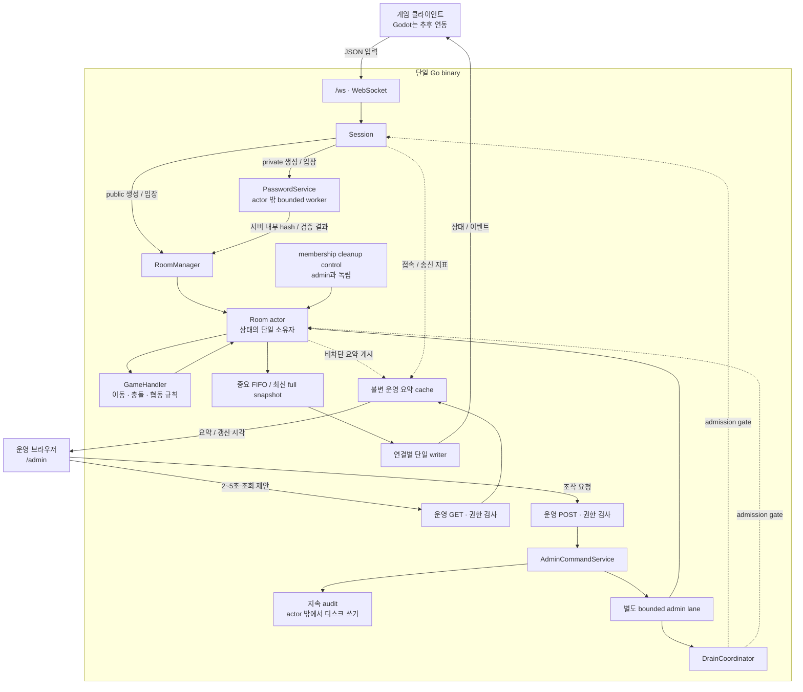
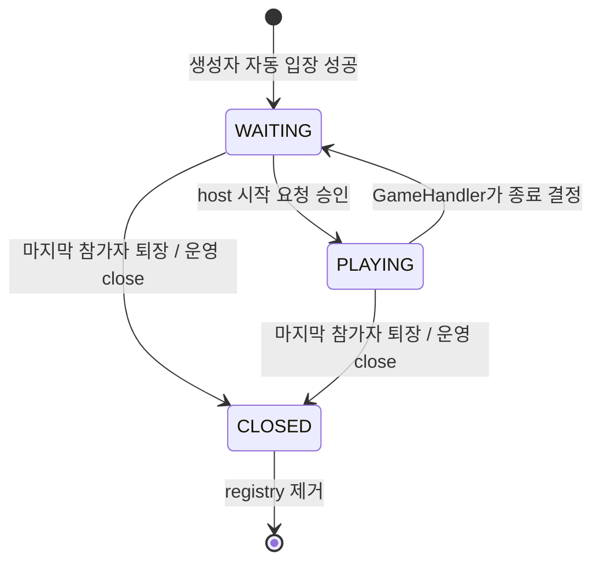
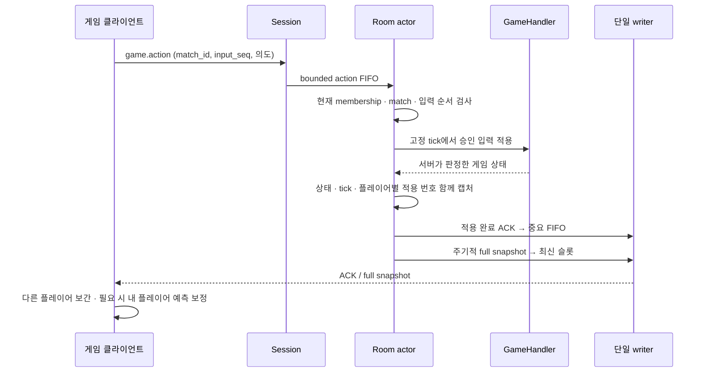
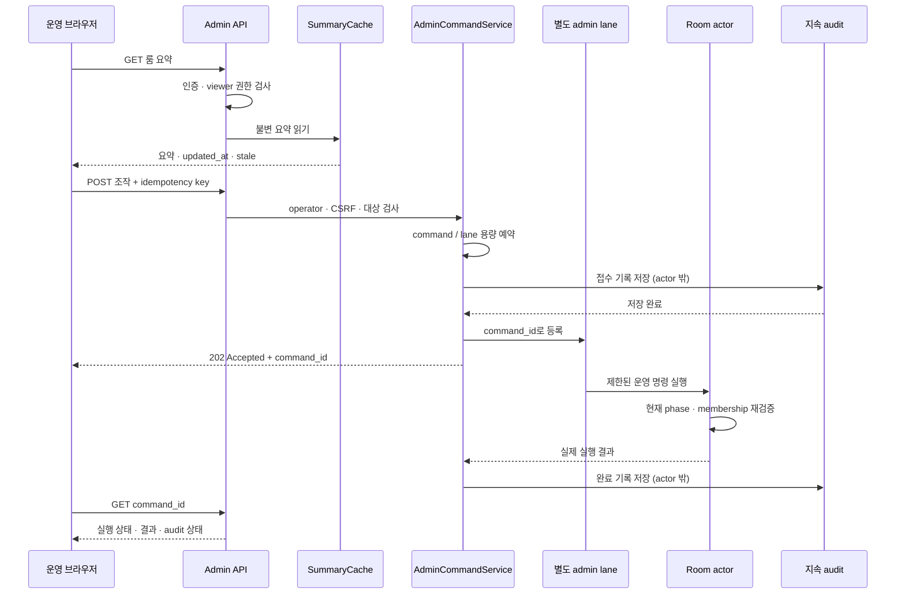

# Go 룸형 협동 게임 서버 전체 설계

**1~6명 실시간 협동 룸과 운영 대시보드를 하나의 Go 서버로 구성한다.**
게임 입력, 운영 조회, 운영 조작은 서로 다른 경로를 사용한다.
아래 문서는 전체 설계이며, 실제 제품 코드·게임 구현·성능 테스트 결과는 아직 없다.



## 1. 범위와 기본 정책

### 확정 요구사항

- Go 서버를 먼저 만든다. 게임 클라이언트·SDK 구현은 이번 범위에 포함하지 않는다.
- 룸당 1~6명이 실시간 이동·협동 플레이를 한다.
- 참가자는 룸 번호를 입력해 입장한다. 프라이빗 룸은 생성자가 지정한 비밀번호를 확인한다.
- 이후 Godot `WebSocketPeer`에서 custom JSON 프로토콜을 사용한다.
- 전용 SDK는 필수가 아니며 공개 JSON 계약으로 직접 연결할 수 있다.
- 운영 대시보드와 운영 조회·제어 API를 전체 구성에 포함한다.

### 초기 설계 제안

| 영역 | 기본 정책 |
|---|---|
| 실행 / 저장 | 단일 프로세스, 세션·룸·게임 상태는 메모리에 저장 |
| 통신 | `net/http` + `github.com/coder/websocket` |
| 접속 | 연결별 guest 세션, 한 세션은 한 룸 |
| 생성 | 정원 기본 6명, 지정 시 1~6 검증, 생성자 자동 입장. 공개·프라이빗 선택, 기본 공개 제안 |
| 룸 번호 | ASCII 숫자 6자리 문자열 제안. 선행 0 보존, 활성 룸 사이 중복 금지 |
| 입장 | 번호로 `WAITING` 룸에 입장. 프라이빗은 생성자가 정한 비밀번호 확인 |
| 룸 목록 | 플레이어의 `room.list`는 공개 룸만 표시, 운영 목록은 프라이빗도 포함 |
| 비밀번호 | 4~64 Unicode 문자 제안, 대소문자 구분. 룸 수명 동안 공개 여부·비밀번호 고정 |
| 시작 | host만 요청 가능, 1명으로도 시작 가능 |
| host 퇴장 | 남은 참가자 중 가장 먼저 입장한 사람으로 승계 |
| 빈 룸 | 마지막 참가자 퇴장 시 즉시 닫고 registry에서 제거 |
| 게임 계산 / 전송 | 계산 30Hz / full snapshot 15Hz를 측정 시작값으로 제안 |
| 대시보드 | 같은 binary에서 HTML·작은 JS 제공, 2~5초 polling 제안 |
| 구현 순서 | 게임 코어와 읽기 전용 운영 화면 우선, 조작과 지속 audit은 함께 추가 |

### 후속 범위

게임별 `GameHandler`, Godot 표시·보간·예측, 운영 계정의 구체적 인증 방식은 후속 구현 대상이다.
다중 프로세스, DB 게임 상태 저장, 자동 재접속 복원은 초기 설계에 포함하지 않는다.
서버 재시작 시 메모리의 세션·룸·게임 상태는 사라진다.
`PLAYING` 룸의 재입장을 허용하지 않으므로 새 guest 연결로 이전 게임에 자동 복귀할 수 없다.

## 2. 서버 구성과 기술 선택

| 모듈 | 책임 |
|---|---|
| Transport / Protocol | HTTP·WebSocket 연결, JSON 검사, 메시지 크기 제한 |
| Session | 서버 발급 ID, Read 루프, 룸 예약, 송신 관리 |
| RoomManager | 짧은 mutex로 내부 ID·번호 registry 보호, 번호 예약·생성·조회 |
| PasswordService | actor 밖의 제한된 worker에서 private 비밀번호 hash 생성·검증 |
| Room actor | 멤버·host·게임 상태 소유, 입장·입력·tick·운영 명령 처리 |
| GameHandler | 게임별 입력 검증, 이동·충돌·협동 규칙, 종료 결정 |
| SummaryCache | 불변 운영 요약의 게시·조회, 갱신 시각과 stale 표시 |
| AdminCommandService | 권한·중복 요청 검사, 접수·결과 관리, audit 연계 |
| DrainCoordinator | 입장 차단과 진행 게임 대기, 종료 단계 조율 |

룸당 actor goroutine 하나만 변경 가능한 멤버·host·게임 상태를 변경한다.
`RoomManager`는 멤버와 게임 상태를 직접 변경하지 않는다.
룸 actor 안에서는 socket 쓰기, HTTP 응답 대기, 디스크 audit, DB 호출, 비밀번호 hash 계산을 하지 않는다.
host는 시작 권한을 가지며, 게임 판정 권한은 서버에 있다.
`GameHandler`를 구현해야 실제 게임이 된다. 범용 메시지 중계만으로 게임 규칙이 생기지는 않는다.

| HTTP 선택 | 판단 |
|---|---|
| `net/http` | 게임·운영 endpoint를 제공하는 초기 기본 선택 |
| Gin | 익숙하거나 HTTP API 확장이 필요하면 선택 가능. [WrapH](https://pkg.go.dev/github.com/gin-gonic/gin#WrapH)와 [Hijacker를 포함한 ResponseWriter](https://pkg.go.dev/github.com/gin-gonic/gin#ResponseWriter) 지원 |
| Fiber v3 | [fasthttp 기반](https://docs.gofiber.io/). 공식 adaptor와 [contrib WebSocket](https://docs.gofiber.io/contrib/v3_websocket_v1.x.x/websocket/) 경로를 사용하고 해당 upgrade 동작을 확인 |

HTTP framework가 게임 동기화를 제공하지는 않는다.
WebSocket 후보 [coder/websocket](https://pkg.go.dev/github.com/coder/websocket)은 [ISC 라이선스](https://github.com/coder/websocket/blob/master/LICENSE.txt)다.

## 3. 룸 수명과 입장 경합

### 사용자가 입력하는 번호와 내부 ID

`room_number`는 사람이 입력하고 친구에게 전달하는 번호다. 초기 제안은 `"004271"`처럼 **숫자 6자리 문자열**이다.
정수로 바꾸면 앞의 0이 사라지므로 메시지·표시·조회 모두 문자열로 다룬다.
`room_id`는 생성 후 고정한 내부 식별자이며 membership·운영 경로·비동기 결과가 대조할 기준이다.
클라이언트 입장은 `room_number`를 사용하고 운영 명령의 대상은 기존 `room_id`를 사용한다.

[crypto/rand.Int](https://pkg.go.dev/crypto/rand#Int)로 번호 후보를 만들고, RoomManager의 짧은 mutex 안에서 중복 검사와 번호 예약을 원자적으로 처리한다.
무작위 번호도 충돌할 수 있으므로 활성 룸과 생성 중 예약 번호 모두 검사하고, 충돌 재시도 횟수에는 상한을 둔다.
상한 안에 번호를 확보하지 못하면 `SERVER_BUSY`로 실패한다. 번호는 룸 수명 동안 고정이며 닫힌 뒤 재사용할 수 있다.
재시작하면 메모리의 번호 매핑도 사라진다. **룸 번호 자체는 인증 수단이 아니다.**

### 생성과 입장 흐름

생성자는 `capacity`, `visibility`를 지정한다. `visibility`는 `public` 또는 `private`이며 미지정 시 `public`을 초기값으로 제안한다.
private 생성에는 `password`가 필수이고, public 생성에 password를 보내면 `INVALID_MESSAGE`다.
비밀번호 길이는 **4~64 Unicode 문자(code point)**를 초기 제안으로 두며 메시지 크기 제한도 적용한다.
대소문자를 구분하고 서버가 임의로 앞뒤 공백을 제거하거나 Unicode 정규화를 하지 않는다.
공개 여부·비밀번호는 룸 수명 동안 고정하며 host가 승계되어도 생성자의 설정을 유지한다.
비밀번호 변경·초기화 기능은 이번 설계에 추가하지 않는다.

1. 생성이 확정되면 생성자는 자동 입장하고 host가 된다. 응답에 번호를 포함하되 비밀번호는 되돌려 보내지 않는다.
2. 친구는 `room.join`에 번호만 보낸다. public이면 일반 입장을 처리한다.
3. private에 비밀번호 없이 요청하면 `PASSWORD_REQUIRED`를 반환한다. 클라이언트는 비밀번호 입력을 받고 같은 번호와 비밀번호로 다시 요청한다.
4. 일치하지 않으면 `PASSWORD_INVALID`, 존재하지 않는 번호면 `ROOM_NOT_FOUND`다. 별도 lookup 메시지는 필요하지 않다.
5. 비밀번호가 맞아도 `WAITING`·정원·연결·서버 수용 조건을 만족해야 실제 입장이 성공한다.

현재 membership을 유지하는 동안 게임 시작이나 다음 판마다 비밀번호를 다시 입력하지 않는다.
퇴장 후 새 입장을 요청하거나 새 guest 연결로 들어올 때는 다시 확인한다.
`PLAYING`은 올바른 비밀번호가 있어도 새 입장·재입장을 허용하지 않는다.
플레이어의 `room.list`에는 public만 표시하고 private는 번호와 비밀번호를 공유해 입장하도록 제안한다.

### 룸 상태



게임 종료 후에는 게임 상태를 초기화해 `WAITING`으로 돌아간다.
일부 참가자의 진행 중 퇴장은 기본적으로 게임을 유지하고 `GameHandler.OnLeave`에 알린다.
인원 부족에 따른 종료·승패는 게임 규칙으로 결정한다.
hook 실패를 이유로 끊어진 세션의 퇴장을 되돌리지 않는다.

### 비밀번호 확인과 입장 확정

비밀번호 원문은 저장하지 않는다. private 룸에는 룸별 무작위 salt, Argon2id hash와 계산 파라미터를 서버 내부에 보관한다.
[OWASP Password Storage 지침](https://cheatsheetseries.owasp.org/cheatsheets/Password_Storage_Cheat_Sheet.html)의 Argon2id·고유 salt 원칙을 참고한다.
지침의 19MiB / 2회 / 병렬도 1은 보안 기준이며 이 서버의 처리 성능을 보장하는 값은 아니다. 실제 비용을 측정해 설정한다.
[argon2.IDKey](https://pkg.go.dev/golang.org/x/crypto/argon2#IDKey)의 salt는 호출자가 만들고 memory 단위는 KiB다.
이 함수에는 context가 없으므로 요청 취소로 이미 실행 중인 연산이 즉시 끝난다고 가정하지 않는다.
hash 생성·검증은 actor 밖의 bounded worker에서 처리하고 worker 동시성·대기 용량을 제한한다.
private 생성도 hash 계산 후 생성 admission을 재검사하며, 실패 시 미공개 룸·번호·세션 예약을 정리한다.

입장은 `JOINING → JOINED` 예약을 사용한다. **JOINING은 같은 세션의 중복 입장 방지이며 빈자리 확보가 아니다.**
정원 검사와 멤버 추가는 룸 actor 안에서 한 작업으로 처리한다.
생성자 입장이 실패한 룸은 registry에 게시하지 않고 제거한다.

번호를 해석할 때 실제 `room_id`를 한 번 확정하고, 서버 내부 비밀번호 검증 결과를 그 ID와 session reservation generation에 묶는다.
클라이언트가 주장하는 “검증 성공”을 신뢰하지 않는다. 늦은 결과를 번호로 다시 조회해 적용하지 않는다.
번호가 재사용돼도 이전 룸의 결과로 새 룸에 들어갈 수 없어야 한다.

예약에 내부 generation을 부여한다.
actor는 검증 후 같은 session lock에서 예약 generation·취소 여부·연결·현재 membership을 확인한다.
대상 룸의 `WAITING`·정원·admission gate도 다시 확인하고 멤버 추가와 `JOINED` 연결을 원자적으로 확정한다.
timeout·disconnect·drain·room close가 먼저면 예약을 무효화해 늦은 join을 거부한다.
이미 확정된 join이라면 control 경로로 퇴장시킨 뒤 예약을 해제하며, 정리가 끝나기 전에는 다른 룸 입장을 허용하지 않는다.
늦은 결과는 generation을 비교해 새 예약을 변경하지 않는다.

drain 전환과 신규 WS 등록·create·join·start의 최종 commit은 같은 짧은 admission gate 안에서 확정한다.
검사 후 lock을 풀고 commit하는 경로를 두지 않는다.
네트워크 대기, 큐 대기, 비밀번호 hash 계산, 긴 GameHandler 작업 동안 gate lock을 유지하지 않는다.
닫히는 룸은 admission을 닫고 대기 요청에 `ROOM_CLOSED`를 반환한 뒤 registry에서 제거한다.

실패 시도를 제한하는 TTL counter를 IP·세션·실제 룸 ID별로 두고, 전체 hash worker 상한을 함께 적용하도록 제안한다.
IP는 신뢰할 proxy 정책에 맞게 얻는다. 단순한 세션 제한만 두면 재접속으로 우회할 수 있다.
제한 중에는 `RATE_LIMITED`, worker 포화에는 `SERVER_BUSY`를 반환한다. 다른 참가자까지 영구적으로 잠그는 룸 lockout은 두지 않는다.
[OWASP login throttling 지침](https://cheatsheetseries.owasp.org/cheatsheets/Authentication_Cheat_Sheet.html#login-throttling)을 참고하되 계정 잠금·복잡도 정책을 공유 룸 비밀번호에 그대로 적용하지 않는다.
시도 횟수·TTL·worker 수는 아직 미측정이며 구현 후 정상 입장과 악의적인 반복 요청의 비용을 함께 측정한다.

## 4. 실시간 게임 데이터 흐름



클라이언트는 이동 방향·버튼 등의 의도를 보낸다.
실제 위치·충돌·승패는 서버가 판정하며 룸 actor만 상태를 변경한다.

| 항목 | 초기 제안 |
|---|---|
| 게임 계산 | 고정 tick 30Hz |
| 상태 전송 | full snapshot 15Hz, 계산 주기와 별도 설정 |
| 입력 | 세션별 `input_seq`, 이동·일회성 행동 모두 FIFO |
| 응답 | 승인된 입력을 실제 적용한 뒤 ACK |
| 표시 | 다른 플레이어 보간, 내 조작 지연이 문제라면 로컬 예측·서버 보정 |

**30Hz / 15Hz는 미측정 튜닝 시작값이며 성능 보장이 아니다.**
계산 비용·응답성·전송량을 측정해 조정한다.
모든 변경을 즉시 broadcast하지 않고 snapshot 주기에 최신 전체 상태를 만든다.
턴제 확장 시에는 행동 적용 뒤 상태를 전송하는 이벤트 기반 모드를 선택할 수 있다.

내 플레이어를 예측하면 같은 snapshot 안의 상태·`server_tick`·자신의 `last_processed_input_seq`를 기준으로 보정한다.
개별 action ACK만으로 미처리 입력을 버리지 않는다.
상태를 그대로 대입하는 것만으로 반응성과 부드러움이 보장되지는 않는다.
예측 도입 시 Godot 물리와 Go GameHandler 계산의 일치를 검증해야 한다. 예측 코드는 이번 산출물이 아니다.

WebSocket의 TCP 손실은 이후 데이터의 순서 대기를 만든다.
최신 슬롯은 이미 전송된 TCP 데이터의 지연까지 없애지는 못한다.
빠른 경쟁 게임으로 요구가 바뀌면 UDP 계열을 검토한다.
[Godot ENet / @rpc](https://docs.godotengine.org/en/4.7/tutorials/networking/high_level_multiplayer.html#high-level-vs-low-level-api)와 일반 Go 서버는 자동 호환되지 않는다.

## 5. 게임 JSON 프로토콜과 송신 순서

요청·응답은 `version`, `op`, `request_id`, `payload`, `error`를 사용한다.
응답은 요청과 같은 `op`와 `request_id`를 반환하며 서버 이벤트의 `request_id`는 `null`이다.
`request_id`는 응답 연결 용도이고 중복 실행 방지는 보장하지 않는다.

```json
{"version":1,"op":"room.create","request_id":"req-001","payload":{"capacity":6,"visibility":"private","password":"coop2026"},"error":null}
```

```json
{"version":1,"op":"room.join","request_id":"req-002","payload":{"room_number":"004271"},"error":null}
```

private 룸에 번호만 보내면 다음 오류를 받고 같은 번호와 password로 재요청한다.

```json
{"version":1,"op":"room.join","request_id":"req-002","payload":null,"error":{"code":"PASSWORD_REQUIRED","message":"Room password is required."}}
```

```json
{"version":1,"op":"room.join","request_id":"req-003","payload":{"room_number":"004271","password":"coop2026"},"error":null}
```

```json
{"version":1,"op":"game.action","request_id":"input-42","payload":{"match_id":"match-7","input_seq":42,"action":{"type":"move","direction":{"x":1,"y":0}}},"error":null}
```

| op | 의미 |
|---|---|
| `session.guest` | 서버가 발급한 `session_id` |
| `room.create` / `room.list` / `room.join` | 공개·프라이빗 생성 / 공개 룸 목록 / 번호 입장 |
| `room.leave` / `room.start` | 퇴장·host 시작 |
| `game.action` | match와 입력 번호를 포함하는 게임 의도 |
| `game.started` / `game.ended` | match 시작·종료, 중요 FIFO |
| `game.event` | `event_id`를 갖는 일회성 이벤트, 중요 FIFO |
| `room.state` | 룸 변화의 메타데이터, 중요 FIFO |
| `game.snapshot` | 주기적 full snapshot, 최신 슬롯에서 교체 가능 |

full snapshot은 `room_id`, `room_number`, `visibility`, `match_id`, `phase`, `host_id`, `members`, `revision`, `game_state`, `server_tick`, `snapshot_seq`, `last_processed_input_seq`를 담는다.
`room.state.payload`와 `game.snapshot.payload`는 이 구조를 사용하되 op별 처리 기준은 다르다.
`members`는 입장 순서다. GameHandler가 아직 없으면 `game_state`는 `null`이다.

| 필드 | 역할 |
|---|---|
| `room_id` / `room_number` / `visibility` | 고정 내부 ID / 사람이 입력하는 번호 문자열 / public·private 구분 |
| `input_seq` | 세션 수명 동안 증가하는 입력 번호, match 변경 시에도 유지하며 중복·역순 검사 |
| `match_id` | 서버 발급 게임 ID, 이전 게임의 입력 거부 |
| `revision` | 룸·게임 상태 변경 버전 |
| `server_tick` | match별 실제 계산 step 번호, 새 match마다 시작 |
| `snapshot_seq` | 룸 수명 전체에서 단조 증가, 새 match에도 초기화하지 않음 |
| `last_processed_input_seq` | `session_id → 실제 적용 완료 입력 번호` map |
| `event_id` | 중요 이벤트의 식별자, snapshot 순번과 독립 |

snapshot의 상태·tick·플레이어별 적용 번호는 actor가 같은 시점에 캡처한다.
클라이언트는 map에서 자신의 입력 확인 번호를 읽는다.
입력 ACK는 mailbox 수신·예약 완료를 뜻하지 않는다.
시작·종료 때 입력 버퍼를 정리하고, 적용 직전에도 현재 match를 확인한다.
정리되는 미적용 요청에는 실패 응답을 보내며, 실제 적용 없이 성공 ACK를 반환하거나 요청을 조용히 버리지 않는다.

`room.state`는 `revision` 기준으로 처리한다.
오래된 `snapshot_seq`와 종료된 `match_id` 필터는 `game.snapshot`의 게임 상태에만 적용한다.
이 필터로 룸 퇴장·종료 메타데이터나 중요 join/start 초기 snapshot을 버리지 않는다.

성공한 create/join 응답의 `payload.snapshot`에 초기 full 상태를 넣고 중요 FIFO에 먼저 등록한다.
응답이 송신되기 전에는 후속 snapshot이 먼저 나가지 않는 연결별 송신 fence를 유지한다.
이 fence는 admission gate와 별개이며 네트워크 송신 동안 admission gate lock을 유지하지 않는다.
`game.started.payload.snapshot`도 초기 full 상태를 담는다.
시작·종료 때 이전 latest snapshot을 폐기하고 시작/종료 이벤트와 `room.state`를 중요 FIFO에 넣는다.
writer는 이 fence를 넘어서 새 snapshot을 보내지 않는다. 이미 쓰기 중이던 이전 snapshot은 해당 중요 이벤트 전에 완료된다.

아직 보내지 않은 full snapshot만 최신 것으로 교체한다. `snapshot_seq` 중간 누락은 정상이다.
이동 입력과 일회성 행동은 모두 FIFO이며 승인 입력마다 실제 적용 후 응답한다.
지속 입력 교체는 생략된 요청의 응답 정책을 정의한 뒤 후속 최적화로 검토한다.
최신 슬롯은 일회성 이벤트를 대신하거나 delta chain을 전송하는 용도로 쓰지 않는다.

숨겨진 정보가 있는 게임은 GameHandler가 사용자별 공개 상태를 만든다.
클라이언트의 ID·위치·승패를 믿지 않고 연결의 세션으로 권한과 입력을 검사한다.
`room.list` 이후 또는 번호를 직접 입력한 실제 join에서 정원·phase를 다시 검사한다.
필수 오류는 `ROOM_FULL`, `ROOM_NOT_FOUND`, `ROOM_IN_PROGRESS`, `ALREADY_IN_ROOM`, `NOT_HOST`, `INVALID_MESSAGE`다.
비밀번호·제한 오류로 `PASSWORD_REQUIRED`, `PASSWORD_INVALID`, `RATE_LIMITED`를 추가한다.
종료·권한·혼잡 오류는 `ROOM_CLOSED`, `NOT_IN_ROOM`, `SERVER_BUSY`다. 번호 형식·visibility·password 길이가 잘못되면 `INVALID_MESSAGE`다.
private의 비밀번호·hash·salt는 create/join 응답, `room.state`, `game.snapshot`을 포함한 공개 상태에 넣지 않는다.
비밀번호 원문·검증값·요청 전체 payload를 로그에 남기지 않으며 실패 기록은 오류 코드와 횟수 등 비밀정보 없는 필드만 사용한다.
운영 환경은 WSS를 사용한다. [OWASP WebSocket 보안 지침](https://cheatsheetseries.owasp.org/cheatsheets/WebSocket_Security_Cheat_Sheet.html)

## 6. 동시성·큐·연결 수명

[Go의 goroutine과 channel](https://go.dev/doc/effective_go#concurrency)을 사용하되, 변경 가능한 룸 상태는 한 actor가 소유한다.
외부에는 복사본이나 불변 요약만 게시한다.

| 경로 | 한계와 동작 |
|---|---|
| action FIFO | 유한 크기, 포화 시 오류 반환; 오류 송신도 불가하면 연결 종료 |
| cleanup control | 룸 정원 이상 크기, membership별 한 번만 등록, 취소된 연결 context와 독립 |
| admin lane | 별도 유한 큐, 처리량 제한, 포화 시 조작 거절; cleanup 슬롯 차용 금지 |
| 중요 송신 FIFO | 응답·룸 변경·게임 이벤트 순서 유지, 포화 시 close + cleanup |
| 최신 snapshot 슬롯 | 연결별 한 개, 미전송 full 상태만 교체 |
| Read / Write | 연결별 Read 루프 하나, Write 루프 하나 |

cleanup을 우선 처리하고 admin 처리는 tick 진행을 막지 않도록 제한한다.
actor가 자기 룸의 송신 포화를 처리할 때는 퇴장을 직접 적용하거나 비차단으로 등록한다.
자기 control 큐 enqueue에서 기다리지 않는다.
이미 종료된 룸의 cleanup은 멱등적으로 완료 처리한다.
HTTP·audit·송신 큐가 혼잡해도 membership cleanup은 독립적으로 동작해야 한다.

외부가 쓰는 mailbox를 닫아 `send on closed channel`을 만들지 않는다.
actor 종료는 `done` / context 취소로 알린다.
중요 응답·이벤트를 조용히 버리지 않는다. socket 쓰기를 actor에서 기다리지 않는다.

[coder/websocket.Conn](https://pkg.go.dev/github.com/coder/websocket#Conn)의 오류·context timeout으로 닫힌 연결은 재사용하지 않는다.
[Accept](https://pkg.go.dev/github.com/coder/websocket#Accept) 이후 장기 연결은 서버가 관리하는 context로 유지한다.
HTTP handler 반환 시 취소되는 `r.Context()`를 WebSocket 수명의 기준으로 사용하지 않는다.

## 7. 운영 대시보드와 조회 cache

대시보드는 [Go embed](https://pkg.go.dev/embed)로 HTML·CSS·작은 JS를 binary에 포함한다.
[FileServerFS](https://pkg.go.dev/net/http#FileServerFS) 또는 `http.FileServer(http.FS(...))`로 정적 파일을 제공한다.
외부 frontend framework나 Node 빌드는 필수가 아니다.
embed 리소스는 선언하는 Go 패키지 안의 하위 폴더에 둔다.

| 화면 | 내용 |
|---|---|
| 서버 개요 | RUNNING / DRAINING / STOPPING, readiness, 접속·룸 수 |
| 룸 목록 | public·private 모두 포함. 내부 room ID, room number, visibility, phase, 인원/정원, host, match ID, 요약 갱신 시각 |
| 룸 상세 | 공개 운영 요약, tick·큐·송신 지표, 현재 참가자 |
| 연결 현황 | 세션 연결 상태, 송신 대기·slow close 원인 등 집계 |
| 조작 결과 | command ID, 접수·실행 상태, 결과, audit 상태 |
| 데이터 신선도 | `updated_at`, summary age, stale 표시 |

조회는 불변 운영 요약 cache만 읽는다.
HTTP GET마다 actor를 호출하거나 전체 `game_state`를 직렬화하지 않는다.
room actor와 WS 경로가 낮은 비용으로 비차단 요약을 게시하고 집계기가 cache를 갱신한다.
전송 큐나 cache 갱신이 게임 tick을 기다리게 해서는 안 된다.

브라우저 polling은 2~5초를 초기 제안으로 두고 요약 게시 주기·stale 임계값을 설정한다.
요약은 갱신 시각을 포함하며 오래되면 stale로 표시한다.
아직 수집하지 않은 지표는 0으로 가장하지 않고 `미측정`으로 표시한다.
게임의 full snapshot 주기와 운영 화면의 갱신 주기는 별개다.
룸 목록은 페이지나 개수 한계를 적용한다.
운영 summary·cache·룸 상세에는 번호와 공개 여부를 표시하되 password·hash·salt를 포함하지 않는다.
actor 내부 private 데이터 구조를 통째로 직렬화하지 않고 공개 가능한 필드만 복사한다.

## 8. HTTP API와 운영 인증

| Method / path | 기능 | 권한 |
|---|---|---|
| GET `/healthz` | 프로세스 liveness | 최소 상태 |
| GET `/readyz` | 신규 게임 수용 readiness, drain 중 실패 | 최소 상태 |
| GET `/ws` | WebSocket upgrade | 게임 guest 연결 |
| GET `/admin` | 운영 HTML | 운영 인증 |
| GET `/admin/api/status` | 현재 instance ID, 서버·집계·종료 진행 요약 | viewer / operator |
| GET `/admin/api/rooms` | 개수 제한 룸 목록 | viewer / operator |
| GET `/admin/api/rooms/{id}` | 룸 운영 요약 | viewer / operator |
| GET `/admin/api/commands/{command_id}` | 실제 실행·audit 상태 | viewer / operator |
| POST `/admin/api/rooms/{id}/kick` | 현재 룸의 대상 membership 종료 | operator |
| POST `/admin/api/rooms/{id}/close` | 룸 입장 차단·종료·cleanup | operator |
| POST `/admin/api/server/drain` | 서버 입장 차단과 종료 진행 요청 | operator |

명령 조회는 `server_instance_id`, `command_id`, 실행 상태, 실제 결과·실패 사유, 접수·완료 시각, `audit_failed`를 구분해 반환한다.
운영 요약에는 현재 참가자의 membership 식별자를 포함해 조작 대상과 현재 membership을 대조할 수 있게 한다.

게임 guest·룸 비밀번호와 운영 인증을 분리한다. 룸 비밀번호로 운영 권한을 얻을 수 없다.
운영 환경의 admin 화면과 API는 HTTPS로 제공한다.
viewer는 조회, operator는 조작 권한을 가지며 API 서버에서 검사한다.
UI 버튼 숨김만으로 권한을 대신하지 않는다.
구체적인 계정·로그인 구현은 후속이며, 읽기 MVP부터 서버 인증·권한 검사는 필요하다.

GET으로 상태를 변경하지 않는다.
cookie 인증의 변경 요청은 CSRF 방어와 Origin 검증을 적용하고 SameSite만으로 대신하지 않는다.
[OWASP CSRF 지침](https://cheatsheetseries.owasp.org/cheatsheets/Cross-Site_Request_Forgery_Prevention_Cheat_Sheet.html)을 따른다.



## 9. 운영 명령·audit·drain

### 접수와 실제 결과

`202 + command_id`는 접수이며 실행 성공이 아니다.
인증·권한·중복·용량 검사 후 command와 admin lane 용량을 예약한다.
실행 전 접수 audit 저장에 성공하고 명령을 lane에 등록한 뒤에만 202를 반환한다.
접수 저장 실패나 lane 포화는 조작을 거부하며 actor가 실행하지 않는다.
lane 자리 예약은 durable 접수 이후 enqueue가 포화로 실패하지 않도록 유지한다.
접수 저장 후 enqueue 전에 종료되어 실행 여부를 확정하지 못한 명령은 `unknown`으로 남기며 자동 replay하지 않는다.

상태는 `queued → running → succeeded / failed`로 기록한다.
actor의 실제 결과를 기준으로 상태를 갱신한다.
이미 퇴장·삭제된 대상은 `no_op` 결과를 명시하고, 실행 조건이 맞지 않으면 실패 이유를 반환한다.
예약 이후 명령 수명은 서버가 소유한다. HTTP `r.Context()` 취소가 접수된 조작을 제거하거나 실행을 실패로 단정하지 않는다.
timeout·재시작으로 결과를 확정하지 못하면 `failed`와 구분한 `unknown`으로 표시하고 자동 재실행하지 않는다.

kick은 대상의 room ID와 membership 식별자를 현재 값과 대조한 뒤 session closing / cleanup 경로로 처리한다.
전역 session ID만 보고 이미 다른 룸으로 이동한 연결을 닫지 않는다.
close는 해당 룸 admission을 닫고 참가자 종료·cleanup과 registry 제거를 수행한다.
모든 룸 변경은 actor 경로를 사용한다.

운영자 + idempotency key에 같은 명령 내용이 오면 같은 command를 반환한다.
같은 key에 다른 내용이면 409를 반환한다.
이 중복 방지는 현재 `server_instance_id`와 retention TTL 안에서 보장한다.
서버는 기동마다 새 instance ID를 발급하고 운영 POST가 그 ID를 지정하도록 한다. 이전 instance를 지정한 요청은 거절한다.
초기 제안은 bounded command store와 보관 TTL이며 구체적인 크기·기간은 운영 규모에 맞춰 설정한다.
만료·재시작을 넘는 영구 중복 방지는 보장하지 않으며 이전 instance의 `unknown` 명령을 자동 replay하지 않는다.
재시작 시 audit에 접수만 남은 명령은 보관 범위 안에서 `unknown` 조회 기록으로 복원하고 실행 큐에는 등록하지 않는다.

### 지속 audit

운영자, command ID, 대상 내부 `room_id`·membership, 명령, 접수·완료 시각, 실제 결과를 지속 기록한다.
room password·hash·salt·요청 전체 payload를 audit에 포함하지 않는다. 실패 로그는 비밀정보 없는 오류 코드·횟수만 기록한다.
audit 디스크 쓰기는 actor 밖의 전용 writer와 제한된 작업 큐에서 처리한다.
writer의 메모리 buffer에 전달한 것만으로 durable 접수가 완료되지 않는다. 설정한 디스크 동기화 기준을 충족한 뒤 저장 완료를 통지한다.
게임 상태는 메모리에서 유실되지만 audit 파일은 재시작 후에도 남는 persistent 저장소다.
로그 rotation·보관 기간은 초기 제안으로 두고 저장 실패 상태를 운영 화면에 표시한다.
명령 실행 상태와 audit 저장 상태는 별도 필드다.

실행 후 audit 저장이 실패하면 실제 실행 상태를 유지하고 `audit_failed`를 별도로 표시한다.
새로운 운영 조작 접수를 차단하고 조회에서 audit 실패를 표시한다.
이미 실행된 조작을 자동으로 다시 실행하지 않는다.

### Drain과 종료

drain command의 `succeeded`는 신규 입장 차단 전환 완료를 뜻한다.
이후 진행 match 대기·연결 종료·프로세스 종료 진행은 서버 상태로 따로 보여준다.
따라서 202 접수, 입장 차단 완료, 서버 종료 완료를 같은 상태로 취급하지 않는다.
서버 수명은 `RUNNING → DRAINING → STOPPING`으로 전환한다.

1. admission gate를 닫아 신규 WS 세션 등록과 create / join / start를 차단하고 `/readyz`에 503을 반환한다.
2. `DRAINING`에서 진행 중인 match를 유지하고 `running_matches == 0` 또는 설정 deadline에 도달하면 `STOPPING`으로 전환한다.
3. WebSocket을 registry에서 명시적으로 close / cancel한다.
4. membership cleanup을 반영하고 room actor와 Read / Write 루프를 기다린다.
5. 제한 시간 안에서 audit를 flush하고 HTTP·프로세스 종료를 마무리한다.

[http.Server.Shutdown](https://pkg.go.dev/net/http#Server.Shutdown)은 WebSocket 같은 hijacked 연결을 닫거나 기다리지 않는다.
위 close / cancel / wait는 별도 구현한다.
종료 단계에서 대시보드 연결이 끊어질 수 있으며 이를 명령 실패로 단정하지 않는다.

## 10. 운영 지표 정의

| 지표 | 정의 / 수집 경계 |
|---|---|
| 접속 수 | 현재 연결된 game session 수 |
| 룸·인원 | WAITING / PLAYING별 룸 수, 룸별 현재 인원·정원 |
| uptime / heap / goroutine | 프로세스 실행시간과 Go runtime 메모리·goroutine 수; actor 밖에서 수집 |
| 목표 / 실제 tick | 설정 Hz / 관측 시간 동안 실제 완료한 계산 step 수 |
| 목표 / 실제 snapshot | 설정 Hz / 실제 생성·송신한 full 상태 빈도 |
| tick 처리시간 | 한 계산 step에 사용한 시간 분포 |
| tick 밀림 | 예정 계산 시각 대비 실제 실행 지연 |
| 큐 점유 | action / cleanup control / 중요 FIFO / admin lane의 사용량과 한계 |
| snapshot 교체 | 미전송 full 상태가 최신 값으로 대체된 횟수 |
| 송신 | 쓰기 대기·실패, 중요 큐 포화와 slow close 횟수 |
| RTT | heartbeat 또는 echo의 왕복 시간; 화면 도착·표시 지연과 다름 |
| 클라이언트 지연 | 수신·보간·표시 지연은 후속 클라이언트 계측 없으면 미측정 |
| CPU | 후속 OS sampler 옵션; 현재 수집·측정했다고 주장하지 않음 |
| 운영 상태 | command 결과, audit 오류, cache 갱신 시각·stale |

CPU·RTT·클라이언트 도착 지연은 실제 수집 경로가 있을 때만 값을 표시한다.
server와 client의 시계 차이를 무시한 시각 차를 도착 지연으로 사용하지 않는다. RTT는 같은 측정 주체의 왕복 시간으로 계산한다.
비공개 정보가 있는 게임의 상태 비교는 모든 참가자에게 공통으로 공개된 세계 상태를 기준으로 한다.
전체 룸 수·실행 장비·게임 계산 복잡도가 미정이므로 수용 인원이나 무지장 플레이를 보장하지 않는다.

## 11. 코드 구조와 설정

```text
cmd/server/main.go
internal/
  transport/
    http.go
    websocket.go
  protocol/message.go
  session/
    client.go
    registry.go
  room/
    manager.go
    room.go
    password.go
  game/handler.go
  admin/
    http.go
    auth.go
    command.go
    web.go
    web/
      index.html
      app.js
      style.css
  observability/
    summary.go
    metrics.go
  audit/store.go
  lifecycle/drain.go
  config/config.go
```

`admin/web.go`가 같은 패키지 하위의 `web/`을 embed한다.
별도 frontend build를 초기 필수로 두지 않는다. 위 트리는 구현할 위치이며 실제 파일은 아직 만들지 않았다.

| 설정 묶음 | 내용 |
|---|---|
| 게임 | 정원 기본·상한, tick Hz, snapshot Hz |
| 번호·입장 | 번호 길이 제안 6, 충돌 재시도 상한, private password 길이 제안 4~64 Unicode 문자 |
| 비밀번호 비용 | Argon2id 파라미터, hash worker 동시성·대기 한계, IP/session/room 실패 횟수·TTL; 실측 후 확정 |
| 연결 | 최대 세션, 메시지 크기, 읽기·쓰기·입장 timeout |
| 큐 | action, cleanup control, 중요 FIFO, 별도 admin lane 한계 |
| 운영 조회 | summary 게시·polling 간격, stale 기준, 목록 개수 한계 |
| 운영 조작 | 처리량, command store 크기·TTL, 인증·권한 설정 |
| audit | 저장 위치, 작업 큐 한계, rotation, 오류 상태 |
| 종료 | drain deadline, 연결/actor 대기 상한, audit flush 상한 |
| 전체 제한 | 최대 룸 수, 접속 수; 실측 후 조정 |

## 12. 구현 순서와 검증

전체 설계에는 운영 조작을 포함한다.
초기 개발 순서는 읽기 전용 운영 MVP를 먼저 검증하고 조작과 지속 audit를 함께 추가하는 방식이다.

| 단계 | 구현 범위 | 통과 기준 |
|---|---|---|
| 1 | 연결·guest·프로토콜·번호·public/private 룸·hash worker | 번호·비밀번호 입장, 정원과 one-room-per-session, host 승계·빈 룸 삭제 |
| 2 | 이동·협동 GameHandler | 승인 입력 적용, match와 snapshot 계약 |
| 3 | 실시간 동기화 | 실제 6클라이언트, tick·전송·보간 검증 |
| 4 | 읽기 전용 대시보드 | 인증·권한, 불변 cache, stale 표시, 게임 영향 측정 |
| 5 | 운영 조작 + 지속 audit | 202·실제 결과 구분, idempotency 경계, 권한·CSRF·audit 오류 |
| 6 | drain·종료·운영 부하 | 입장 경합·큐 포화·종료 시간·로그 flush 검증 |

- 동시 join이 정원을 넘지 않고 같은 세션의 두 룸 입장을 막는다.
- 선행 0 번호·번호 충돌·닫힌 번호 재사용을 확인하고, 늦은 검증 결과가 재사용 번호의 새 룸에 적용되지 않는다.
- 공개 룸의 번호 입장, private 비밀번호 누락·오류·재요청, host 승계 후 같은 비밀번호 유지, PLAYING 거절을 확인한다.
- private 생성·검증 중 timeout·disconnect·close·drain과 정원 경합을 시험하고 미공개 룸·번호·예약이 남지 않는다.
- 응답·snapshot·운영 cache·로그·audit에 password·hash·salt가 노출되지 않으며 임시 시도 제한이 정상 입장을 영구 차단하지 않는다.
- join/disconnect, timeout 직후 다른 룸 입장, 늦은 join 결과에도 이전 membership이 남지 않는다.
- host 승계·비참가자 명령·닫힌 룸 대기 요청이 정해진 정책을 따른다.
- 지연·jitter·손실·느린 수신자를 재현하고 같은 match의 동일 revision / tick에서 공개 상태를 비교한다.
- 입력 적용 순서, snapshot 상태·tick·플레이어별 ACK, 시작/종료 fence와 일회성 이벤트 보존을 확인한다.
- tick 실행시간·밀림, snapshot 전송량·도착 지연, 룸 간 영향을 측정한다.
- 반복 private 입장과 hash worker 포화의 CPU·메모리 비용 및 게임 tick 영향을 측정한다. actor 밖 계산도 같은 프로세스의 자원을 사용한다.
- 운영 GET 반복·admin lane 포화·audit 저장 지연이 tick과 cleanup을 막지 않는지 확인한다.
- 이미 다른 룸으로 이동한 세션을 stale kick으로 닫지 않는다.
- 변경 GET·미인증·viewer 조작·CSRF 요청을 거부하고 audit 접수 실패 시 실행하지 않는다.
- 실행 후 audit 실패와 실제 실행 결과를 분리하며 자동 재실행하지 않는다.
- drain과 신규 접속·create·join·start 경합에서 gate를 지키고, WebSocket·actor를 제한 시간 안에 정리한다.
- 구현 후 `go test -race`로 공유 상태 경합을 검사한다. 이 문서는 해당 테스트를 실행했다는 보고가 아니다.

## 13. 프로젝트 이름 후보

| 후보 | 의미 / 추천 이유 |
|---|---|
| **CoopDock · 코옵독** | **1순위 추천.** co-op + dock, 협동 팀이 모여 연결하는 기지라는 목적을 표현 |
| PartyDock · 파티독 | 파티가 모이는 곳, 룸·팀 구성 기능을 쉽게 연상 |
| CrewTick · 크루틱 | 협동 팀과 서버 계산 tick을 함께 표현 |
| RoomPier · 룸피어 | 여러 룸이 모이는 부두를 연상 |
| TickCove · 틱코브 | 실시간 계산과 작은 협동 공간을 연상 |

2026-10-10 공개 GitHub 저장소명 초기 검색에서 다섯 후보의 exact 동일 이름을 발견하지 못했으며, 이 검색은 유일성·도메인·상표를 보장하지 않는다.
이름은 추천 후보이며 아직 채택하거나 파일·폴더를 개명하지 않았다.
