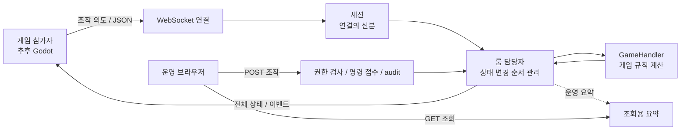

# 01. 전체 개요와 이름 후보

**Go 서버 하나가 1~6명의 협동 룸과 운영 대시보드를 함께 담당하는 설계입니다.**
참가자는 조작 의도를 보내고, 서버는 실제 게임 결과를 계산해 참가자에게 알려줍니다.
운영자는 브라우저로 서버와 룸 상태를 조회하고 필요한 조작을 요청합니다.

## 확정 요구사항과 현재 상태

| 구분 | 내용 |
|---|---|
| 확정 요구사항 | Go 서버 우선, 룸당 1~6명 실시간 이동·협동 |
| 확정 요구사항 | 룸 번호 직접 입력, 프라이빗은 생성자가 지정한 비밀번호 확인 |
| 확정 요구사항 | Godot 활용, 운영 대시보드와 조회·제어 API 포함 |
| 초기 설계 제안 | 단일 프로세스·메모리 기반 룸, `net/http` + `coder/websocket` |
| 초기 연결 제안 | Godot `WebSocketPeer`에서 custom JSON 사용. 전용 SDK는 필수가 아님 |
| 실제 구현 상태 | 현재 구현 범위·실행 방법·검증은 [서버 README](../server/README.md) 참조 |
| 후속 개발·미검증 | 게임별 GameHandler·Godot 클라이언트·운영 대시보드·운영 부하와 성능 측정 |

여기서 프로세스는 실행 중인 서버 프로그램 하나를 뜻하며, 초기에는 하나로 시작하도록 제안합니다.
메모리 기반은 실행 중에 상태를 보관한다는 뜻이며, **재시작 때 세션·룸·게임 상태가 사라집니다.**

## 두 사람이 협동 게임을 하는 예

1. 민수가 공개 여부를 선택해 룸을 만들면 서버가 번호를 발급하고 민수를 방장으로 등록합니다. private이면 생성 시 비밀번호도 정합니다.
2. 지연이 번호로 입장합니다. private이면 비밀번호를 입력합니다. 민수가 시작을 요청하면 새 게임 한 판이 열립니다.
3. 민수는 “오른쪽 이동”, 지연은 “버튼 누르기”라는 의도를 보냅니다.
4. 서버가 이동·충돌·협동 규칙을 계산하고 두 사람에게 결과 상태를 보냅니다.
5. 운영자는 별도 대시보드에서 룸 인원과 서버 처리 상태를 확인합니다.

방장은 **시작 권한**을 가집니다. 이동·충돌·승패를 정하는 **게임 판정 권한은 서버**에 있습니다.
따라서 클라이언트가 보낸 “내 좌표는 여기”나 “내가 승리”를 결과로 받아들이지 않습니다.

## 구성 그림

그림의 “룸 담당자”는 **room actor**입니다. 한 룸의 변경을 한 곳에서 순서대로 처리합니다.
게임 계산 중에 네트워크 전송이나 디스크 기록을 기다리지 않도록 작업을 분리합니다.

| 구성 | 쉬운 책임 |
|---|---|
| Session | 연결을 읽고, 현재 룸을 기억하고, 보낼 메시지를 관리 |
| RoomManager | 현재 룸과 입력 번호의 매핑 관리 |
| PasswordService | 게임 계산 담당자 밖에서 제한된 동시 작업으로 비밀번호 저장값 생성·검증 |
| Room actor | 참가자·방장·게임 상태를 변경하는 유일한 담당자 |
| GameHandler | 게임에 맞는 이동·충돌·협동·종료 규칙 |
| SummaryCache | 운영 화면이 읽을 요약 복사본과 갱신 시각 보관 |
| AdminCommandService | 운영 조작의 접수와 실제 결과 관리 |
| DrainCoordinator | 신규 입장을 막고 진행 게임과 연결의 종료 조율 |

`GameHandler`를 구현해야 실제 게임이 됩니다. 메시지를 주고받는 것만으로 게임 규칙이 생기지는 않습니다.

## 초기 기술 선택

기본 HTTP 도구는 Go의 `net/http`, WebSocket 도구는 [coder/websocket](https://pkg.go.dev/github.com/coder/websocket)입니다.
이 라이브러리의 라이선스는 [ISC](https://github.com/coder/websocket/blob/master/LICENSE.txt)입니다.
WebSocket은 연결을 유지하며 양방향으로 메시지를 주고받는 통신 방식입니다.

Gin·Fiber는 선택 가능한 HTTP framework입니다. HTTP 경로를 구성하는 도구이며 게임 동기화 자체를 제공하지는 않습니다.
[Gin의 WrapH](https://pkg.go.dev/github.com/gin-gonic/gin#WrapH)로 일반 HTTP handler를 연결할 수 있습니다.
[Fiber는 fasthttp 기반](https://docs.gofiber.io/)이므로 공식 adaptor와 [WebSocket 경로](https://docs.gofiber.io/contrib/v3_websocket_v1.x.x/websocket/)의 동작을 확인해 선택합니다.

Godot는 공개 JSON 계약에 맞춰 직접 연결할 수 있습니다. SDK를 먼저 만들 필요는 없습니다.
Godot의 `@rpc`나 자동 동기화 기능은 custom Go 서버와 자동으로 맞물리지 않습니다. [Godot 공식 설명](https://docs.godotengine.org/en/4.7/tutorials/networking/high_level_multiplayer.html#high-level-vs-low-level-api)

## 초기 범위와 제한

- 번호는 6자리 숫자 문자열, 기본 public, 비밀번호 길이 4~64 Unicode 문자를 제안합니다. 세부 흐름은 [02. 룸과 세션](/Users/sangjinsu/Documents/Codex/2026-10-10/gameanvil/outputs/specs/02-rooms-and-sessions.md)에 있습니다.
- private는 플레이어 공개 목록에서 제외하고 운영 화면에는 번호·공개 여부를 표시합니다. 비밀번호·hash·salt는 공개 상태와 로그에 넣지 않습니다.
- 룸 수명 동안 공개 여부·비밀번호를 고정하며 host가 바뀌어도 유지합니다. 비밀번호 변경 기능은 추가하지 않습니다.
- 자동 재접속 복원은 포함하지 않습니다. 새 guest 연결은 이전 `PLAYING` 룸에 다시 들어갈 수 없습니다.
- 여러 서버에 룸을 분산하거나 DB에 게임 진행 상태를 보관하는 기능은 초기 범위 밖입니다.
- 게임별 규칙, Godot 화면의 부드러운 표시·예측, 운영 로그인 방식은 후속 구현 대상입니다.
- 계산 30Hz·상태 전송 15Hz·운영 조회 2~5초는 **측정을 시작할 제안값**입니다.
- 실제 장비와 게임 계산량을 측정하기 전에는 전체 수용 인원이나 지연 없는 플레이를 보장하지 않습니다.

## 프로젝트 이름 후보

아래 이름은 제안이며 **아직 채택하거나 폴더를 개명하지 않았습니다.**

| 후보 | 의미 |
|---|---|
| **CoopDock · 코옵독** | **1순위 추천.** co-op + dock. 협동 팀이 모여 연결하는 기지 |
| PartyDock · 파티독 | 파티가 모이는 곳. 룸과 팀 구성을 연상 |
| CrewTick · 크루틱 | 협동 팀과 서버 계산 tick을 함께 표현 |
| RoomPier · 룸피어 | 여러 룸이 모이는 부두 |
| TickCove · 틱코브 | 실시간 계산과 작은 협동 공간 |

원본의 초기 공개 검색은 이름의 유일성·도메인 확보·상표 사용 가능성을 확정하지 않습니다.

## 구현 후 확인할 기준

- 두 참가자의 행동 결과를 서버가 결정하고, 방장이 아닌 참가자의 시작 요청을 거부하는가?
- 게임 연결과 운영 조회가 같은 서버에서 동작하며 운영 인증을 게임 guest와 분리하는가?
- 서버 재시작 때 상태가 사라지는 정책과 재접속 제한을 실제 동작으로 확인했는가?
- 공개 번호 입장·프라이빗 비밀번호 확인과 운영 인증의 분리를 확인했는가?
- 설정 주기와 실제 처리 성능을 구분해 측정했는가?

다음: [룸과 세션](/Users/sangjinsu/Documents/Codex/2026-10-10/gameanvil/outputs/specs/02-rooms-and-sessions.md) · [전체 원본](/Users/sangjinsu/Documents/Codex/2026-10-10/gameanvil/outputs/go-room-server-design.md)
